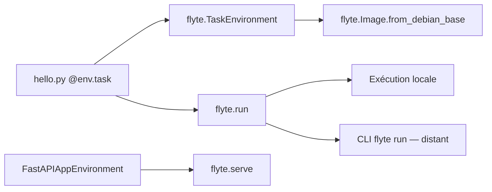

# flyteorg/flyte

> Orchestrator for ML pipelines, models and agents, written and driven in pure Python.

## The problem
Describing an ML pipeline in a DSL or YAML moves the code away from the business logic, and going
from local to cluster usually breaks the development experience.

## What it actually does
A `TaskEnvironment` declares a name and an image; the `@env.task` decorator turns a Python
function — synchronous or `async` — into an orchestrated task. Tasks call each other
with `.aio()` and are parallelized with `asyncio.gather`. `flyte.run()` runs locally, the
`flyte run` CLI runs remotely. A `FastAPIAppEnvironment` serves a model behind FastAPI with
`flyte.serve`. A TUI provides an enriched local experience.

## How it is wired


## Trying it
```bash
uv pip install flyte
uv pip install flyte[tui]
python hello.py
flyte run hello.py main --numbers '[1,2,3]'
flyte serve serving.py env
```

## Cost and gotchas
The main point: **the open-source Flyte 2 back end does not exist yet** — announced as "coming
soon". Today, a ready-to-use production back end goes through Union.ai, which is commercial.
Flyte 1 is still maintained, but on the `master` branch, which makes reading the repository tricky.
The full SDK lives in another repository, `flyte-sdk`.

## What it is not
It is not a general-purpose scheduler like cron. This repository is not the SDK, and not yet the
back end: it mostly contains the protobuf definitions and the contribution guide.

## Alternatives
- **Union.ai**: the commercial back end, if you need production right away.
- **flyte-sdk**: the repository to install if you only want the SDK and dev tools.

## For you
Worth watching for version 2; do not move a pipeline to it as long as the open back end is missing.
