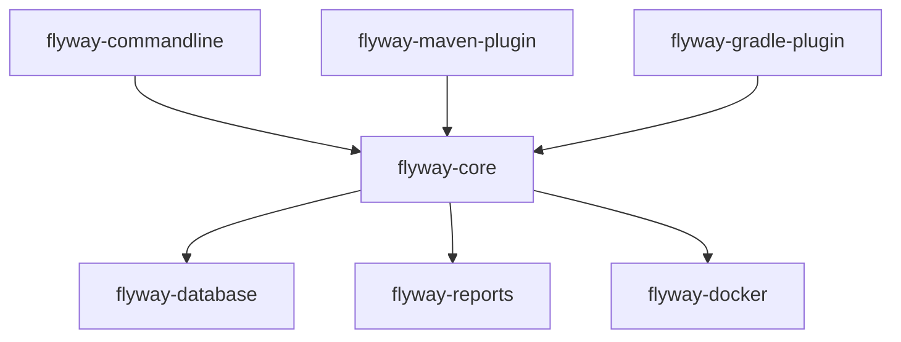

# flyway/flyway

> Database schema migration tool, with a command line, Java and build plugins.

## The problem
Evolving a database schema reproducibly across all instances, without manual scripts.

## What it actually does
A central engine (`flyway-core`) applies versioned migrations. It is driven by a CLI, Maven or Gradle plugins or a Docker image, and contains per-database modules (Oracle, MySQL, PostgreSQL, etc.), plus reports and native connectors. Works on Windows, macOS, Linux, Docker and Java.

## How it is wired

## Trying it
No command in the README: the download and getting-started guides are on the Flyway documentation.

## Cost and gotchas
The open source edition is free; the Redgate Community and Enterprise editions are separate, with a UI and paid features for the latter. Trademark of Boxfuse GmbH, owned by Red Gate Software.

## What it is not
Not a database comparison tool nor a graphical interface: these features are in the Redgate editions, outside the open source project.

## Alternatives
No alternative named in the README (it cites the Redgate editions as richer versions).

## For you
Worth adopting: a proven standard for versioning the schema of the databases feeding your pipelines, to plug into CI or a Maven or Gradle build.
