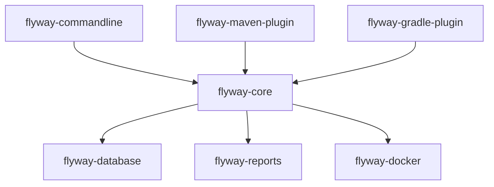

# flyway/flyway

> Outil de migration de schéma de base de données, en ligne de commande, Java et plugins de build.

## Le problème
Faire évoluer le schéma d'une base de façon reproductible sur toutes les instances, sans scripts manuels.

## Ce que ça fait vraiment
Un moteur central (`flyway-core`) applique des migrations versionnées. Il est piloté par une CLI, des plugins Maven ou Gradle ou une image Docker, et contient des modules par base de données (Oracle, MySQL, PostgreSQL, etc.), plus rapports et connecteurs natifs. Fonctionne sur Windows, macOS, Linux, Docker et Java.

## Comment c'est branché

## Essayer
Aucune commande dans le README : le téléchargement et les guides de démarrage sont sur la documentation Flyway.

## Coût et pièges
L'édition open source est gratuite ; les éditions Redgate Community et Enterprise sont distinctes, avec interface et fonctions payantes pour la seconde. Marque déposée de Boxfuse GmbH, détenue par Red Gate Software.

## Ce que ce n'est pas
Pas un outil de comparaison de bases ni d'interface graphique : ces fonctions sont dans les éditions Redgate, hors du projet open source.

## Alternatives
Aucune alternative nommée dans le README (il cite les éditions Redgate comme versions plus riches).

## Pour toi
À adopter : standard éprouvé pour versionner le schéma des bases qui alimentent tes pipelines, à brancher dans CI ou dans un build Maven ou Gradle.

