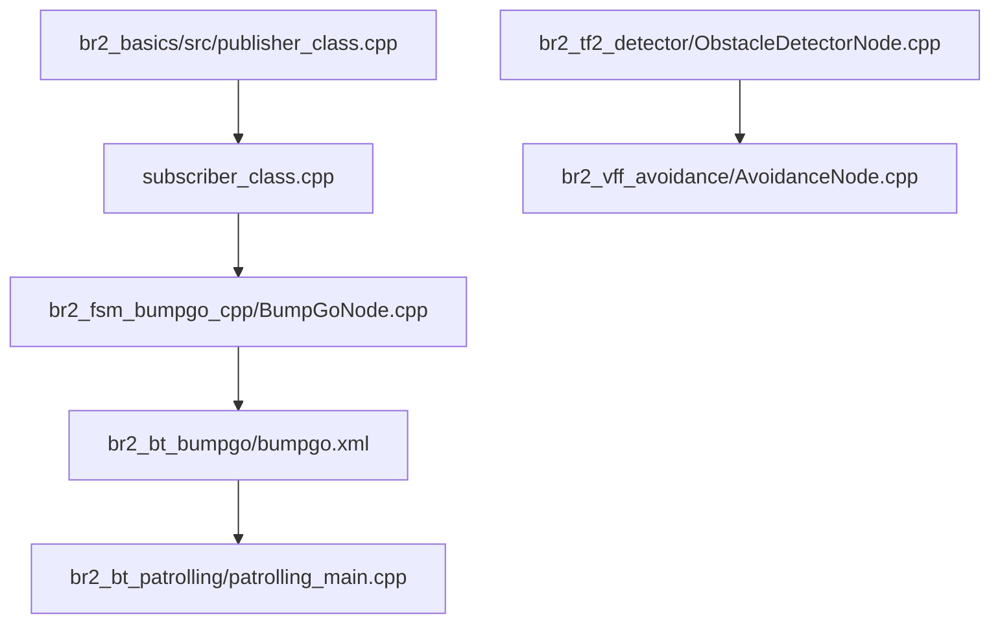

# fmrico/book_ros2

> Source code of the introductory book on robot programming with ROS 2, one package per chapter.

## The problem
Learning ROS 2 requires complete, runnable examples rather than mere book excerpts.

## What it actually does
One package per chapter, from publisher and subscriber nodes to state machines, behavior trees, obstacle detection, VFF avoidance, PID tracking and navigation of the Tiago robot. Branches exist per ROS 2 distribution (Humble, Jazzy, Rolling…). Slides accompany the book.

## How it is wired
Diagram based on the code diagram.

## Trying it
The README gives no build command. It refers to `pixi.md` for the Pixi and RoboStack setup (Jazzy and Kilted).

## Cost and gotchas
Free, but the repository has no declared license. Each branch requires a specific version of Ubuntu and ROS 2 (for example Ubuntu 24.04 with Jazzy).

## What it is not
Not a reusable library: it is the companion code of a book. No link with machine learning.

## Alternatives
No alternative named in the README.

## For you
Ignore unless you have a robotics project: educational ROS 2 examples, outside the data / AI / MLOps scope.
