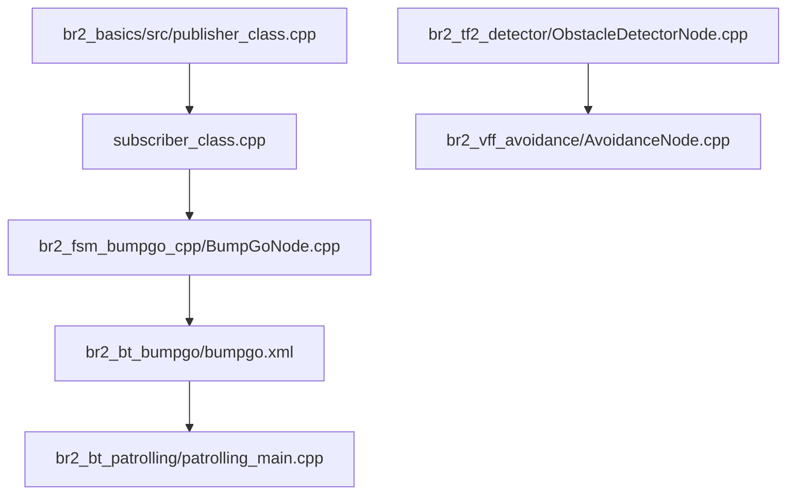

# fmrico/book_ros2

> Code source du livre d'introduction à la programmation de robots avec ROS 2, un paquet par chapitre.

## Le problème
Apprendre ROS 2 demande des exemples complets et exécutables plutôt que de simples extraits de livre.

## Ce que ça fait vraiment
Un paquet par chapitre, des nœuds publisher et subscriber aux machines à états, arbres de comportement, détection d'obstacles, évitement VFF, suivi PID et navigation du robot Tiago. Des branches existent par distribution ROS 2 (Humble, Jazzy, Rolling…). Des diapositives accompagnent le livre.

## Comment c'est branché
Schéma d'après le diagramme du code.

## Essayer
Le README ne donne pas de commande de compilation. Il renvoie à `pixi.md` pour la configuration Pixi et RoboStack (Jazzy et Kilted).

## Coût et pièges
Gratuit, mais le dépôt n'a pas de licence déclarée. Chaque branche exige une version précise d'Ubuntu et de ROS 2 (par exemple Ubuntu 24.04 avec Jazzy).

## Ce que ce n'est pas
Pas une bibliothèque réutilisable : c'est le code d'accompagnement d'un livre. Pas de lien avec le machine learning.

## Alternatives
Aucune alternative nommée dans le README.

## Pour toi
À ignorer sauf projet de robotique : exemples ROS 2 pédagogiques, hors du périmètre data / IA / MLOps.

