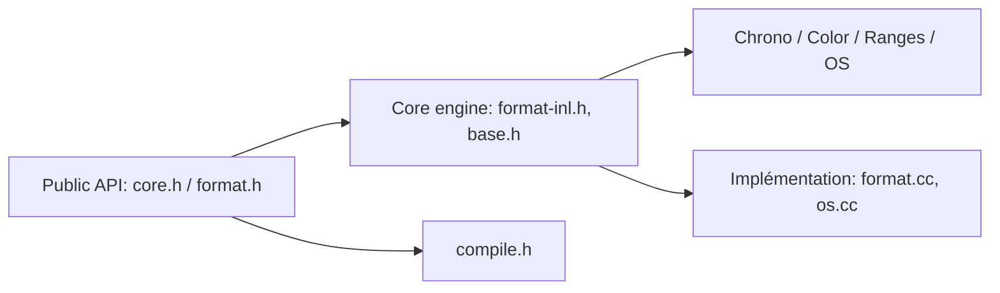

# fmtlib/fmt

> C++ text formatting library, a fast and safe alternative to stdio and iostreams.

## The problem
`printf` is untyped, and iostreams are slow and verbose to compile.

## What it actually does
Implements `std::format` (C++20) and `std::print` (C++23), with a Python-like syntax, positional arguments, compile-time checking of format strings (C++20), colors, dates, containers, and file writing. Floating-point formatting uses Dragonbox. Usable header-only (`FMT_HEADER_ONLY`) or compiled.

## How it is wired


## Trying it
```cpp
#include <fmt/core.h>

int main() {
  fmt::print("Hello, world!\n");
}
```

## Cost and gotchas
Free, no dependencies. The README does not detail the build (CMake and Bazel are mentioned in the architecture).

## What it is not
Not a logging framework: it is a formatting engine (spdlog consumes it).

## Alternatives
- spdlog, Quill: logging libraries built on fmt, cited among its users.

## For you
Relevant only if you write C++ (compute extensions, inference engines); PyTorch already uses it internally.
