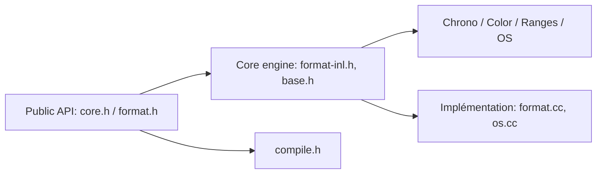

# fmtlib/fmt

> Bibliothèque C++ de formatage de texte, alternative rapide et sûre à stdio et iostreams.

## Le problème
`printf` n'est pas typé et les iostreams sont lents et verbeux à compiler.

## Ce que ça fait vraiment
Implémente `std::format` (C++20) et `std::print` (C++23), avec syntaxe proche de Python, arguments positionnels, vérification des chaînes de format à la compilation (C++20), couleurs, dates, conteneurs, écriture de fichiers. Formatage des flottants par Dragonbox. Utilisable en header-only (`FMT_HEADER_ONLY`) ou compilé.

## Comment c'est branché


## Essayer
```cpp
#include <fmt/core.h>

int main() {
  fmt::print("Hello, world!\n");
}
```

## Coût et pièges
Gratuit, sans dépendance. Le README ne détaille pas le build (CMake, Bazel mentionnés dans l'architecture).

## Ce que ce n'est pas
Pas un framework de journalisation : un moteur de formatage (spdlog le consomme).

## Alternatives
- spdlog, Quill : journalisation s'appuyant sur fmt, citées parmi les utilisateurs.

## Pour toi
Pertinent seulement si tu écris du C++ (extensions de calcul, moteurs d'inférence) ; PyTorch l'utilise déjà en interne.

