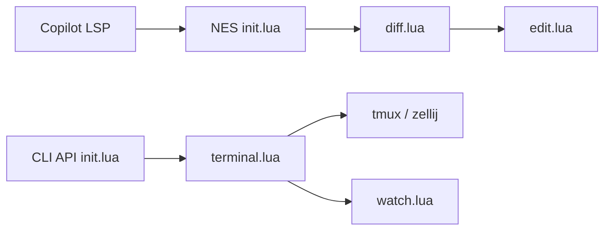

# folke/sidekick.nvim

> Neovim plugin that combines Copilot edit suggestions and an integrated terminal for AI CLIs.

## The problem
Using Copilot and agent CLIs (Claude, Gemini, Codex…) forces you to leave the editor and copy context over.

## What it actually does
Two parts. NES: multi-line edit suggestions via Copilot LSP, inline diffs, hunk navigation. CLI: preconfigured terminal for aider, claude, codex, gemini, opencode, etc., with prompts using variables (`{file}`, `{selection}`, `{diagnostics}`), tmux/zellij persistence and reloading of modified files.

## How it is wired


## Trying it
```bash
# README : Quick Start (lazy.nvim, voir config)
:checkhealth sidekick
:LspCopilotSignIn
:Sidekick cli toggle
```

## Cost and gotchas
NES requires a GitHub Copilot subscription and the copilot-language-server. Neovim >= 0.11.2. The AI CLIs must be installed separately, with their own costs.

## What it is not
Does not replace the inline completions of copilot.lua. The CLIs work without Copilot, but nothing is provided on the model side.

## Alternatives
copilot.lua and copilot.vim for inline completions.

## For you
Worth watching: interesting if you code in Neovim with CLI agents; otherwise nothing for you, and NES assumes a paid Copilot.
