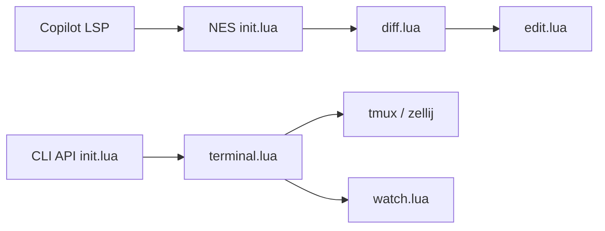

# folke/sidekick.nvim

> Plugin Neovim qui combine suggestions d'édition Copilot et un terminal intégré pour CLI d'IA.

## Le problème
Utiliser Copilot et les CLI d'agents (Claude, Gemini, Codex…) oblige à quitter l'éditeur et à recopier du contexte.

## Ce que ça fait vraiment
Deux volets. NES : suggestions d'édition multi-lignes via Copilot LSP, diffs inline, navigation par hunk. CLI : terminal préconfiguré pour aider, claude, codex, gemini, opencode, etc., avec prompts à variables (`{file}`, `{selection}`, `{diagnostics}`), persistance tmux/zellij et rechargement des fichiers modifiés.

## Comment c'est branché


## Essayer
```bash
# README : Quick Start (lazy.nvim, voir config)
:checkhealth sidekick
:LspCopilotSignIn
:Sidekick cli toggle
```

## Coût et pièges
NES exige un abonnement GitHub Copilot et le serveur copilot-language-server. Neovim >= 0.11.2. Les CLI d'IA sont à installer à part, avec leurs coûts.

## Ce que ce n'est pas
Ne remplace pas les complétions inline de copilot.lua. Les CLI marchent sans Copilot, mais rien n'est fourni côté modèle.

## Alternatives
copilot.lua et copilot.vim pour les complétions inline.

## Pour toi
Surveiller : intéressant si tu codes sous Neovim avec des agents CLI ; sinon rien pour toi, et NES suppose un Copilot payant.

