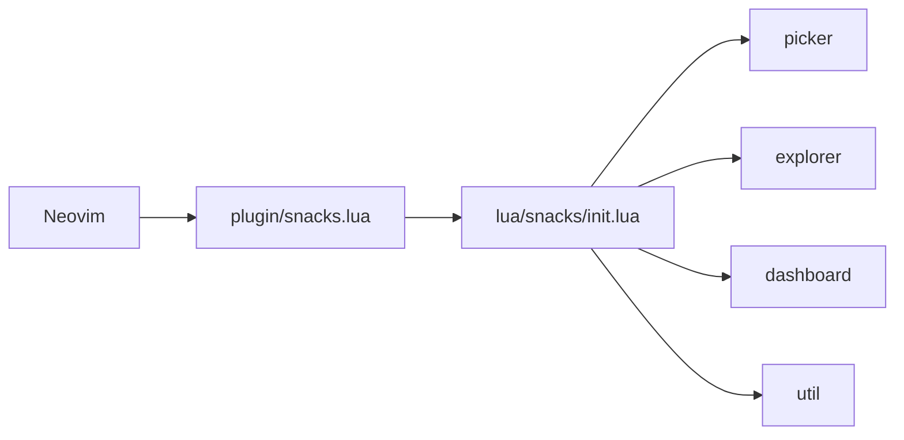

# folke/snacks.nvim

> Collection of small Neovim plugins (picker, explorer, dashboard, notifier, lazygit…) that you enable à la carte.

## The problem
A usable Neovim takes ten scattered plugins, each with its own config and visual style.

## What it actually does
A single Lua repo groups about thirty modules: picker, file explorer, dashboard, notifications, floating terminal, scratch buffers, zen, lazygit and GitHub CLI integration. Nothing is active until you pass `enabled = true` or options. The `plugin/snacks.lua` loader calls `lua/snacks/init.lua`, which dispatches to one file per module.

## How it is wired


## Trying it
```bash
:checkhealth snacks
```
The README mainly provides a lazy.nvim block (`"folke/snacks.nvim"`, `priority = 1000`, `lazy = false`, `opts = { picker = { enabled = true } }`).

## Cost and gotchas
Free. Neovim ≥ 0.9.4 required; Nerd Font and mini.icons/nvim-web-devicons optional. Some modules (image) require kitty, wezterm or ghostty.

## What it is not
Not a turnkey Neovim distribution framework: you write your own config. Not an IDE replacement. The "Setup ‼️" modules must be loaded early.

## Alternatives
No alternative named in the README.

## For you
Useful if you code your notebooks and pipelines in Neovim; otherwise of no interest, since it brings nothing on the data/AI side and relies on a single maintainer.
