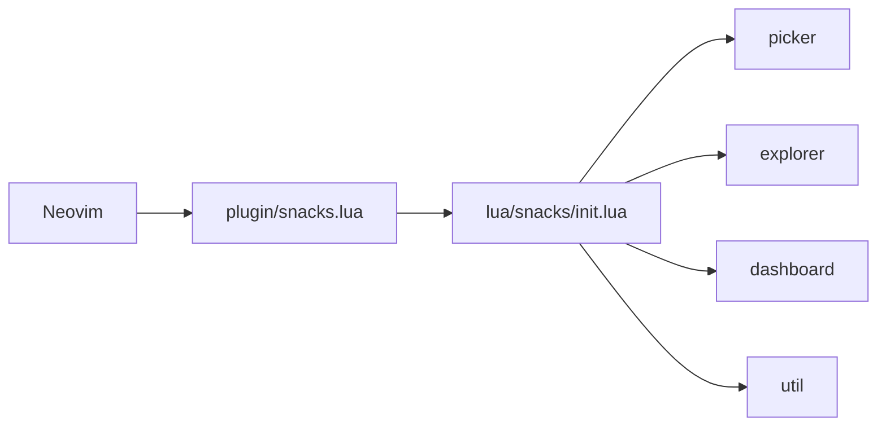

# folke/snacks.nvim

> Collection de petits plugins Neovim (picker, explorer, dashboard, notifier, lazygit…) activables à la carte.

## Le problème
Un Neovim utilisable demande dix plugins épars, chacun avec sa config et son style visuel.

## Ce que ça fait vraiment
Un seul dépôt Lua regroupe une trentaine de modules : picker, explorateur de fichiers, dashboard, notifications, terminal flottant, scratch buffers, zen, intégration lazygit et GitHub CLI. Rien n'est actif tant qu'on ne passe pas `enabled = true` ou des options. Le chargeur `plugin/snacks.lua` appelle `lua/snacks/init.lua`, qui distribue vers un fichier par module.

## Comment c'est branché


## Essayer
```bash
:checkhealth snacks
```
Le README fournit surtout un bloc lazy.nvim (`"folke/snacks.nvim"`, `priority = 1000`, `lazy = false`, `opts = { picker = { enabled = true } }`).

## Coût et pièges
Gratuit. Neovim ≥ 0.9.4 requis ; Nerd Font et mini.icons/nvim-web-devicons optionnels. Certains modules (image) exigent kitty, wezterm ou ghostty.

## Ce que ce n'est pas
Pas un framework de distribution Neovim clé en main : on écrit sa config. Pas un remplaçant de l'IDE. Les modules « Setup ‼️ » doivent être chargés tôt.

## Alternatives
Aucune alternative nommée dans le README.

## Pour toi
Utile si tu codes tes notebooks et pipelines sous Neovim ; sinon sans intérêt, car il n'apporte rien côté data/IA et repose sur un seul mainteneur.

