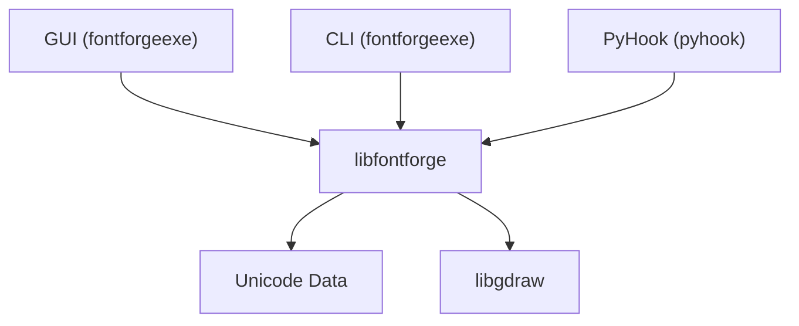

# fontforge/fontforge

> Free font editor to create, modify and convert fonts on Windows, Mac and Linux.

## The problem
Creating or converting fonts (OpenType, TrueType, UFO) requires a dedicated editor.

## What it actually does
The README is very short. Based on the architecture, the core library handles the font model, drawing goes through libgdraw, a GTK graphical interface and command-line tools drive the core, and a Python hook allows automation.

## How it is wired


## Trying it
```bash
# Aucune commande dans le README ; voir fontforge.org
# et designwithfontforge.com pour le manuel.
```

## Cost and gotchas
Free. The license is present but not identified by GitHub: check it before any use. The tracker is for bugs, not questions.

## What it is not
It is not an online typography tool nor an AI font generator.

## Alternatives
No alternative named in the README.

## For you
Ignore: font editing with no link to data/AI/MLOps, the license still needs to be confirmed.
