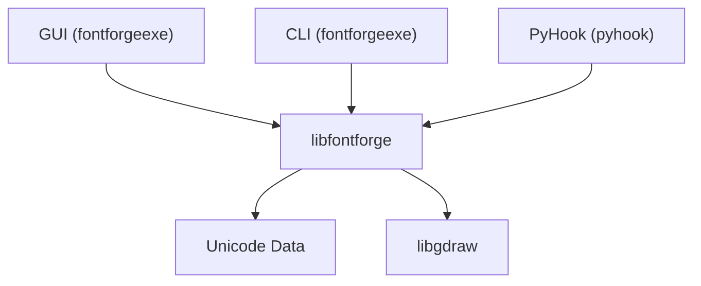

# fontforge/fontforge

> Éditeur de polices libre pour créer, modifier et convertir des fontes sous Windows, Mac et Linux.

## Le problème
Créer ou convertir des polices (OpenType, TrueType, UFO) demande un éditeur dédié.

## Ce que ça fait vraiment
Le README est très court. D'après l'architecture, la bibliothèque centrale gère le modèle de police, le dessin passe par libgdraw, une interface graphique GTK et des outils en ligne de commande pilotent le noyau, et un accès Python permet l'automatisation.

## Comment c'est branché


## Essayer
```bash
# Aucune commande dans le README ; voir fontforge.org
# et designwithfontforge.com pour le manuel.
```

## Coût et pièges
Gratuit. La licence est présente mais non identifiée par GitHub : à vérifier avant tout usage. Le tracker sert aux bogues, pas aux questions.

## Ce que ce n'est pas
Ce n'est pas un outil de typographie en ligne ni un générateur de polices par IA.

## Alternatives
Aucune alternative nommée dans le README.

## Pour toi
À ignorer : édition de polices sans lien avec data/IA/MLOps, la licence reste à confirmer.

