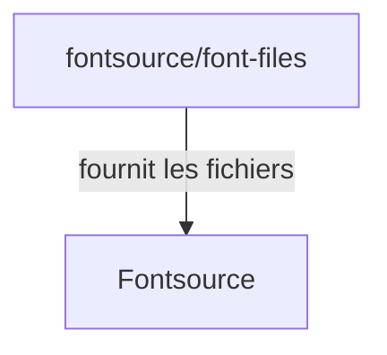

# fontsource/font-files

> Repo that hosts all the font files of the Fontsource project.

## The problem
Fontsource needs a central place to store the font files it distributes.

## What it actually does
It stores the font files. The README says nothing else and points to Fontsource's README.

## How it is wired
Simplified diagram based on the fiche, no diagram provided.


## Trying it
```bash
# Aucune commande documentée.
```

## Cost and gotchas
Not documented. Each font has its own license, not detailed here.

## What it is not
Not a tool nor a library: a simple file warehouse, to be used through Fontsource.

## Alternatives
No alternative named in the README.

## For you
Ignore: a font warehouse unrelated to data or AI, and a README too short to judge further.
