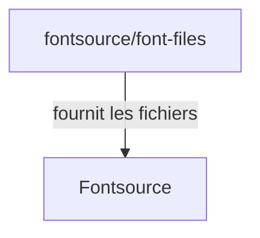

# fontsource/font-files

> Dépôt qui héberge tous les fichiers de polices du projet Fontsource.

## Le problème
Fontsource a besoin d'un endroit central où stocker les fichiers de polices qu'il distribue.

## Ce que ça fait vraiment
Il stocke les fichiers de polices. Le README ne dit rien d'autre et renvoie vers celui de Fontsource.

## Comment c'est branché
Schéma simplifié d'après la fiche, sans diagramme fourni.


## Essayer
```bash
# Aucune commande documentée.
```

## Coût et pièges
Non documenté. Les polices ont chacune leur propre licence, non détaillée ici.

## Ce que ce n'est pas
Pas un outil ni une bibliothèque : un simple entrepôt de fichiers, à utiliser via Fontsource.

## Alternatives
Aucune alternative nommée dans le README.

## Pour toi
À ignorer : entrepôt de polices sans rapport avec la data ou l'IA, et README trop court pour juger davantage.

