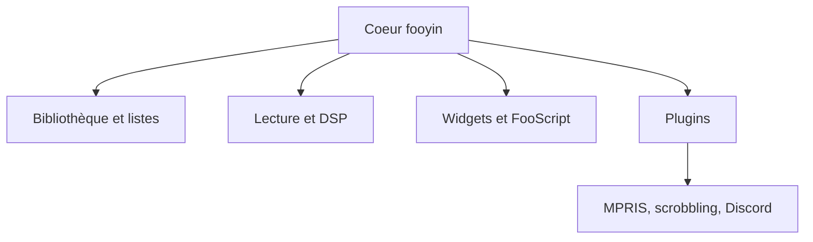

# fooyin/fooyin

> Highly customizable desktop music player, with plugins and the FooScript scripting language.

## The problem
Music players freeze the interface and the formats; you want to organize your library and its display freely.

## What it actually does
Gapless and bit-perfect playback of many formats (FLAC, MP3, Opus, CUE, audio CD on Linux). Library with filters, automatic playlists, tag editor, ReplayGain, audio conversion, MusicBrainz search. Interface that can be recomposed from a blank canvas, plugins for widgets, decoders and DSP, scrobbling and Discord.

## How it is wired
Simplified diagram based on the fiche, no diagram provided.

## Trying it
No command in the README: install from Flathub, distribution repositories or Releases; see BUILD.md for building.

## Cost and gotchas
Free, GPL-3.0. The README mentions no account or key. 353 open issues.

## What it is not
Not a streaming service: it plays local files, radio streams and remote URLs.

## Alternatives
No alternative named in the README.

## For you
Ignore: consumer audio player with no link to data or MLOps.
