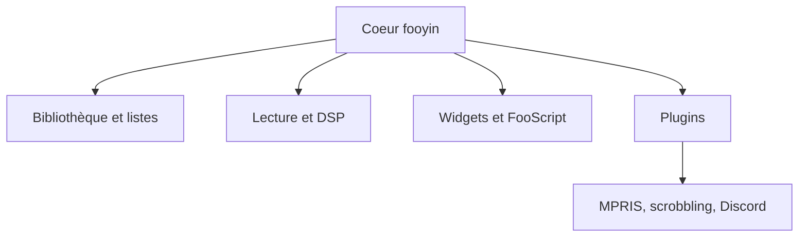

# fooyin/fooyin

> Lecteur de musique de bureau très personnalisable, avec plugins et langage de script FooScript.

## Le problème
Les lecteurs de musique figent l'interface et les formats ; on veut organiser sa bibliothèque et son affichage librement.

## Ce que ça fait vraiment
Lecture gapless et bit-perfect de nombreux formats (FLAC, MP3, Opus, CUE, CD audio sous Linux). Bibliothèque avec filtres, listes de lecture automatiques, éditeur de tags, ReplayGain, conversion audio, recherche MusicBrainz. Interface recomposable depuis une toile vide, plugins pour widgets, décodeurs et DSP, scrobbling et Discord.

## Comment c'est branché
Schéma simplifié d'après la fiche, sans diagramme fourni.

## Essayer
Aucune commande dans le README : installer depuis Flathub, les dépôts de distribution ou les Releases ; voir BUILD.md pour la compilation.

## Coût et pièges
Gratuit, GPL-3.0. Le README ne signale ni compte ni clé. 353 issues ouvertes.

## Ce que ce n'est pas
Pas un service de streaming : il lit des fichiers locaux, des flux radio et des URL distantes.

## Alternatives
Aucune alternative nommée dans le README.

## Pour toi
À ignorer : lecteur audio grand public sans lien avec la data ou le MLOps.

