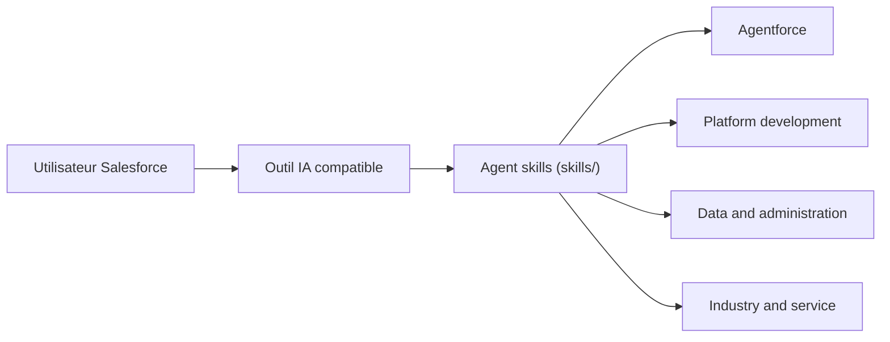

# forcedotcom/sf-skills

> Collection of agent skills for developing on Salesforce (Apex, Flow, LWC, Agentforce).

## The problem
A coding agent poorly knows Salesforce conventions: Apex, SOQL, Flow, LWC components, permissions.

## What it actually does
Repository of "skill" folders (SKILL.md, scripts, references, assets) following the Agent Skills specification. Installs into Claude Code, Codex, Cursor and others, or automatically in Agentforce Vibes. Covers Agentforce, platform, data and administration, industry and service. A samples/ folder syncs from npm.

## How it is wired


## Trying it
```bash
npx skills add forcedotcom/sf-skills
```

## Cost and gotchas
Free, but only useful with a Salesforce org. The README warns: skills are renamed, restructured or removed from one version to the next.

## What it is not
Not an SDK nor a standalone tool: instructions for an agent. The detail of the branches is broader than what the sampled code shows.

## Alternatives
No alternative named in the README.

## For you
Ignore unless you work on Salesforce: without that platform, these skills bring nothing to a data/AI/MLOps profile.
