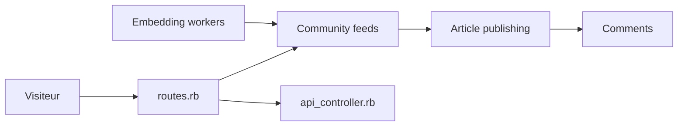

# forem/forem

> Open source Rails community platform that powers dev.to, for anyone building a community.

## The problem
Creating an online community (articles, comments, profiles) without starting from scratch.

## What it actually does
Rails backend, frontend transitioning to Preact. Article feeds, comments, tags, organizations, public API, Stripe webhook, S3 storage. Embeddings feed the stream: PostgreSQL with `pgvector` ≥ 0.8.0 is mandatory; the `GEMINI_API_KEY` key is optional.

## How it is wired


## Trying it
```bash
bundle exec kamal config
bundle exec kamal setup
```
(Kamal deployment, in beta, after configuring `config/deploy.yml` and the environment variables.)

## Cost and gotchas
SSH servers, Docker, container registry, PostgreSQL + pgvector. Gemini optional. Truncated README: the Kamal bash block is not closed and swallows the security section.

## What it is not
Not an analytics or AI tool: a publishing platform. The developer docs may lag behind, according to the README.

## Alternatives
None named in the README.

## For you
Ignore: a community product, outside your data / AI scope; the AGPL is also restrictive if you want to modify it.
