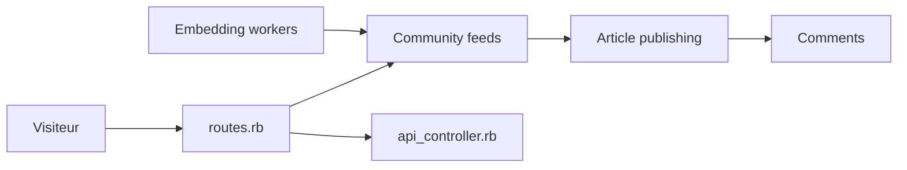

# forem/forem

> Plateforme communautaire open source Rails qui fait tourner dev.to, pour qui monte une communauté.

## Le problème
Créer une communauté en ligne (articles, commentaires, profils) sans repartir de zéro.

## Ce que ça fait vraiment
Backend Rails, frontend en transition vers Preact. Flux d'articles, commentaires, tags, organisations, API publique, webhook Stripe, stockage S3. Des embeddings alimentent le flux : PostgreSQL avec `pgvector` ≥ 0.8.0 est obligatoire ; la clé `GEMINI_API_KEY` est optionnelle.

## Comment c'est branché


## Essayer
```bash
bundle exec kamal config
bundle exec kamal setup
```
(Déploiement Kamal, en beta, après configuration de `config/deploy.yml` et des variables d'environnement.)

## Coût et pièges
Serveurs SSH, Docker, registre de conteneurs, PostgreSQL + pgvector. Gemini facultatif. README tronqué : le bloc bash Kamal n'est pas fermé et avale la section sécurité.

## Ce que ce n'est pas
Pas un outil d'analyse ni d'IA : une plateforme de publication. La doc développeur peut être en retard, selon le README.

## Alternatives
Aucune nommée dans le README.

## Pour toi
Ignorer : un produit de communauté, hors de ton périmètre data / IA ; l'AGPL est de plus contraignante si tu veux le modifier.

