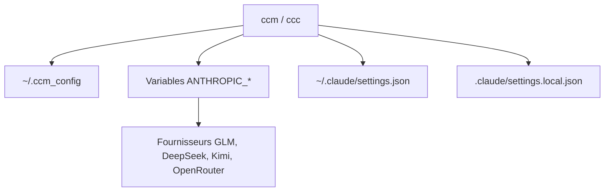

# foreveryh/claude-code-switch

> Shell script to switch Claude Code from one model provider to another with a single command.

## The problem
Using Claude Code with GLM, DeepSeek, Kimi or Qwen forces you to rewrite the ANTHROPIC_* environment variables each time.

## What it actually does
`ccm` exports seven environment variables per provider (base URL, token, models). `ccc` switches then launches Claude Code. Also handles multiple Claude Pro accounts, user-level or project-level settings, and OpenRouter.

## How it is wired
Simplified diagram based on the sheet, no diagram provided.



## Trying it
```bash
curl -fsSL https://raw.githubusercontent.com/foreveryh/claude-code-switch/main/quick-install.sh | bash
source ~/.zshrc
ccm config
ccm glm
```

## Cost and gotchas
One API key per provider, stored in plain text in `~/.ccm_config`. Installation goes through a `curl | bash`. Rewrites `~/.claude/settings.json` with `ccm user`.

## What it is not
Not a proxy or a gateway: it only sets variables. It does not guarantee that the provider is compatible with Claude Code.

## Alternatives
None cited in the README. Quotio is mentioned as another tool that modifies the same settings.

## For you
Watch: handy if you test several models with Claude Code, but a single-person script that handles your keys.
