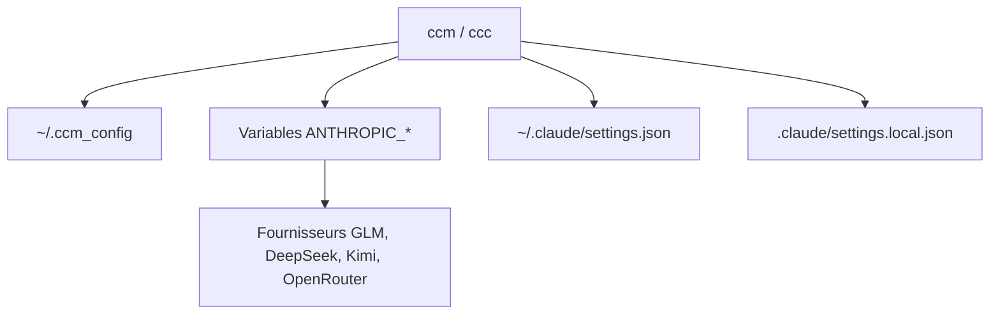

# foreveryh/claude-code-switch

> Script shell pour faire passer Claude Code d'un fournisseur de modèle à un autre en une commande.

## Le problème
Utiliser Claude Code avec GLM, DeepSeek, Kimi ou Qwen oblige à réécrire à chaque fois les variables d'environnement ANTHROPIC_*.

## Ce que ça fait vraiment
`ccm` exporte sept variables d'environnement par fournisseur (URL de base, jeton, modèles). `ccc` change puis lance Claude Code. Gère aussi plusieurs comptes Claude Pro, des réglages au niveau utilisateur ou projet, et OpenRouter.

## Comment c'est branché
Schéma simplifié d'après la fiche, sans diagramme fourni.



## Essayer
```bash
curl -fsSL https://raw.githubusercontent.com/foreveryh/claude-code-switch/main/quick-install.sh | bash
source ~/.zshrc
ccm config
ccm glm
```

## Coût et pièges
Une clé d'API par fournisseur, stockée en clair dans `~/.ccm_config`. L'installation passe par un `curl | bash`. Réécrit `~/.claude/settings.json` avec `ccm user`.

## Ce que ce n'est pas
Pas un proxy ni une passerelle : il ne fait que positionner des variables. Il ne garantit pas que le fournisseur soit compatible avec Claude Code.

## Alternatives
Aucune citée dans le README. Quotio est mentionné comme autre outil qui modifie les mêmes réglages.

## Pour toi
Surveiller : pratique si tu testes plusieurs modèles avec Claude Code, mais un script d'une seule personne qui manipule tes clés.

