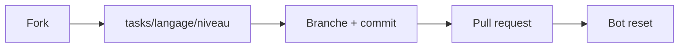

# fork-commit-merge/fork-commit-merge

> Teaching repository for learning the fork-commit-pull-request flow on GitHub through more than 139 tasks.

## The problem
Beginners don't dare make their first open source contribution for lack of a risk-free practice ground.

## What it actually does
You fork, pick a task in `tasks/` (language, then Easy/Medium/Hard), open a PR; a bot resets the files after merge. Covers HTML, Python, Rust, Docker, Kubernetes, etc. The PR is closed without reply within 4 days. Excluded from Hacktoberfest.

## How it is wired


## Trying it
```bash
git clone https://github.com/<your-username>/fork-commit-merge.git
git remote add upstream https://github.com/fork-commit-merge/fork-commit-merge.git
git switch -c fix-issue
```

## Cost and gotchas
Free, GitHub account required. The 142 issues are deliberately open tasks.

## What it is not
Not a software project nor a real contribution: it is an exercise.

## Alternatives
First Contributions, Contribute To This Project, Hello Open Source (cited in the README).

## For you
Ignore: you already master git; useful only to train a beginner.
