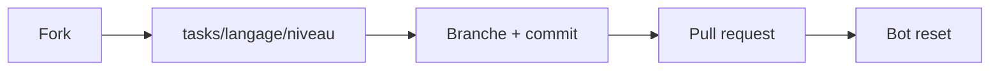

# fork-commit-merge/fork-commit-merge

> Dépôt pédagogique pour apprendre le flux fork-commit-pull-request sur GitHub via plus de 139 tâches.

## Le problème
Les débutants n'osent pas leur première contribution open source faute d'un terrain d'entraînement sans risque.

## Ce que ça fait vraiment
Tu forkes, tu choisis une tâche dans `tasks/` (langage, puis Easy/Medium/Hard), tu ouvres une PR ; un bot remet les fichiers à zéro après fusion. Couvre HTML, Python, Rust, Docker, Kubernetes, etc. La PR est fermée sans réponse sous 4 jours. Exclu de Hacktoberfest.

## Comment c'est branché


## Essayer
```bash
git clone https://github.com/<your-username>/fork-commit-merge.git
git remote add upstream https://github.com/fork-commit-merge/fork-commit-merge.git
git switch -c fix-issue
```

## Coût et pièges
Gratuit, compte GitHub requis. Les 142 issues sont des tâches volontairement ouvertes.

## Ce que ce n'est pas
Pas un projet logiciel ni une contribution réelle : c'est un exercice.

## Alternatives
First Contributions, Contribute To This Project, Hello Open Source (cités dans le README).

## Pour toi
À ignorer : tu maîtrises déjà git ; utile seulement pour former un débutant.

