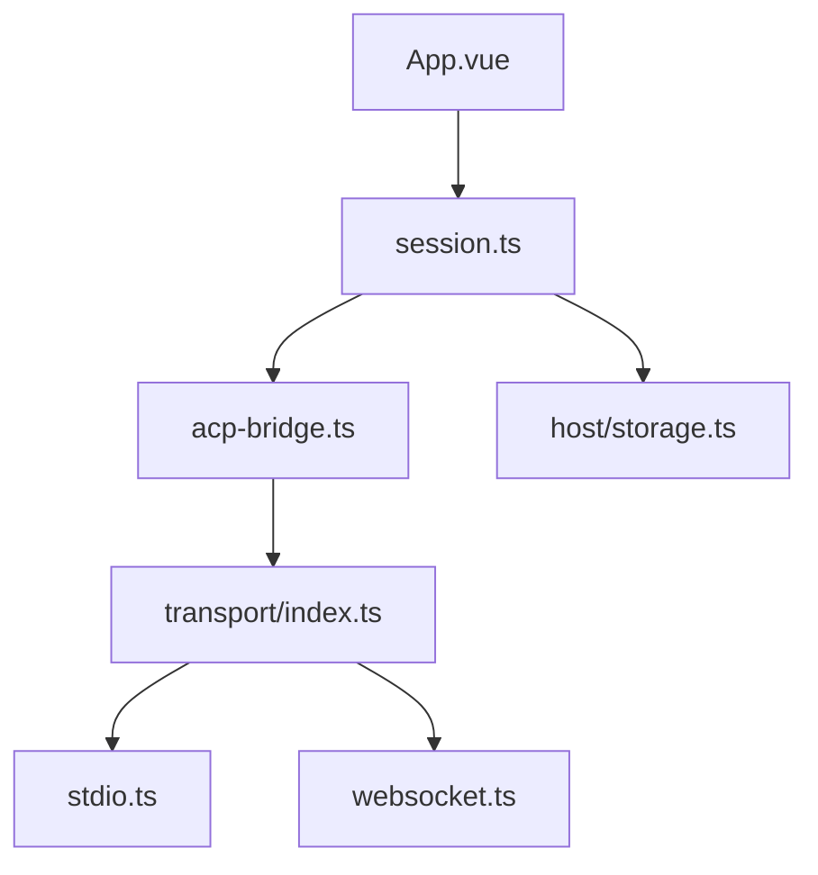

# formulahendry/acp-ui

> Cross-platform client for the Agent Client Protocol to chat with coding agents from desktop, mobile or web.

## The problem
Each coding agent has its own interface. Switching between them, or using one from a phone, is painful.

## What it actually does
A single interface for ACP-compatible agents (Copilot, Claude Code, Gemini CLI, Codex CLI, OpenCode, Kiro, etc.). It handles sessions, permissions, modes, model choice, slash commands and a traffic monitor. The desktop app launches local agents over stdio; web and mobile go through a remote WebSocket.

## How it is wired
Diagram based on the one provided, simplified.



## Trying it
```bash
git clone https://github.com/formulahendry/acp-ui.git
cd acp-ui
npm install
npm run tauri dev
npm run preview:web
```

## Cost and gotchas
The connected agents require their own keys (e.g. ANTHROPIC_API_KEY in `agents.json`). The macOS dmg files are not notarized. Mobile access requires exposing the agent over WebSocket (`stdio-to-ws`, Dev Tunnels).

## What it is not
It is not an agent: it is a client. Web and mobile cannot access the local file system or stdio agents.

## Alternatives
No alternative named in the README.

## For you
Watch: handy if you juggle several coding agents, but the project relies on a single maintainer and a still-young protocol.
