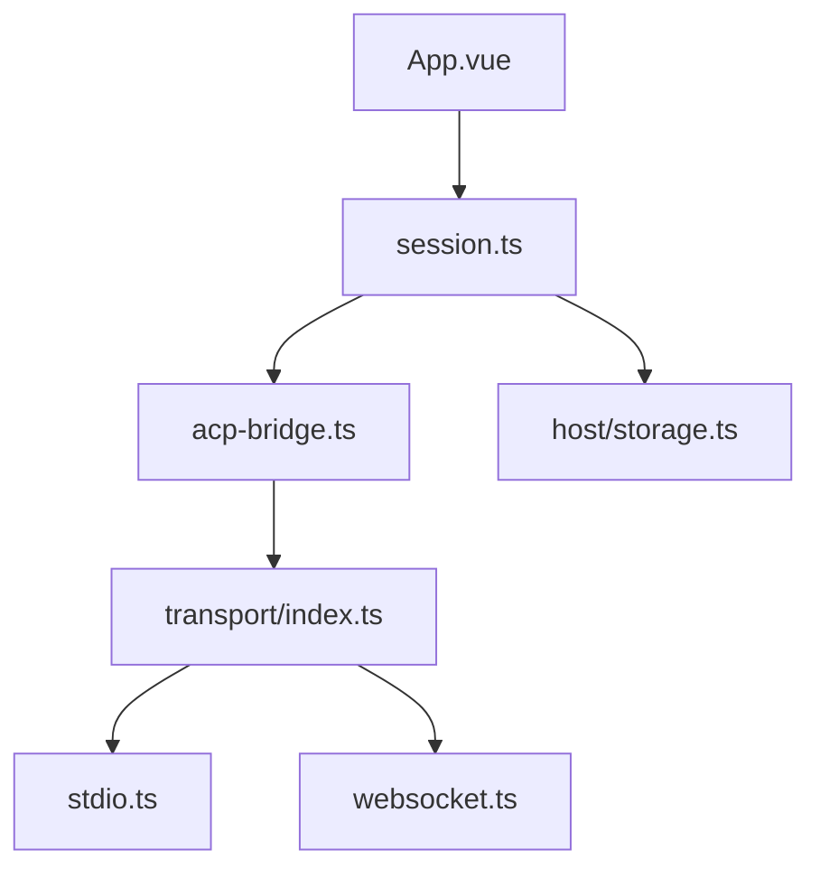

# formulahendry/acp-ui

> Client multiplateforme du protocole Agent Client Protocol pour discuter avec des agents de code depuis bureau, mobile ou web.

## Le problème
Chaque agent de code a sa propre interface. Passer de l'un à l'autre, ou en utiliser un depuis un téléphone, est pénible.

## Ce que ça fait vraiment
Interface unique pour agents compatibles ACP (Copilot, Claude Code, Gemini CLI, Codex CLI, OpenCode, Kiro, etc.). Elle gère sessions, permissions, modes, choix de modèle, commandes slash et moniteur de trafic. Le bureau lance des agents locaux en stdio ; le web et le mobile passent par WebSocket distant.

## Comment c'est branché
Schéma d'après le diagramme fourni, simplifié.



## Essayer
```bash
git clone https://github.com/formulahendry/acp-ui.git
cd acp-ui
npm install
npm run tauri dev
npm run preview:web
```

## Coût et pièges
Les agents branchés exigent leurs propres clés (ex. ANTHROPIC_API_KEY dans `agents.json`). Les dmg macOS ne sont pas notarisés. Un accès mobile exige d'exposer l'agent en WebSocket (`stdio-to-ws`, Dev Tunnels).

## Ce que ce n'est pas
Ce n'est pas un agent : c'est un client. Le web et le mobile n'accèdent pas au système de fichiers local ni aux agents stdio.

## Alternatives
Aucune alternative nommée dans le README.

## Pour toi
À surveiller : pratique si tu jongles entre plusieurs agents de code, mais le projet repose sur un seul mainteneur et un protocole encore jeune.

