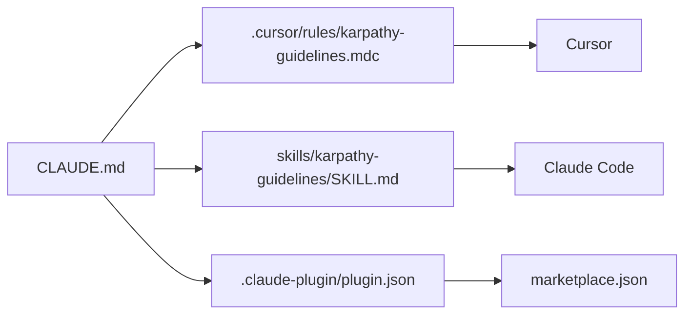

# forrestchang/andrej-karpathy-skills

> A CLAUDE.md file containing four rules of conduct designed to prevent misconduct by software developers.

## The problem
Developers make assumptions about code without verifying them, create unnecessary complexity, and modify neighboring code without being asked.

## What it actually does
A single set of instructions (think before coding, prioritize simplicity, surgical procedures, execution based on verifiable criteria), taken from Andrej Karpathy's comments. The same content is repackaged as the Cursor, Skill, and Claude Code plugin. No code is executed; it's just text.

## How it is wired


## Trying it
```bash
/plugin marketplace add forrestchang/andrej-karpathy-skills
/plugin install andrej-karpathy-skills@karpathy-skills
# ou, par projet :
curl -o CLAUDE.md https://raw.githubusercontent.com/forrestchang/andrej-karpathy-skills/main/CLAUDE.md
```

## Cost and gotchas
Free. The comments add context to each session. Nothing in the README measures their effect: the "it works" criterion is qualitative (smaller differences, questions before code).

## What it is not
Not a tool or a guarantee: a license remains a suggestion that the model can ignore. No declared license: reuse must be clarified before redistribution. The authors themselves acknowledge a bias towards "caution rather than speed".

## Alternatives
- Multica (the author's platform, mentioned at the top of the README): for managing agents with reusable skills.

## For you
Adoption: copying a rules file takes a minute, but it's better to review and adapt it rather than simply copying it onto your own rules.
