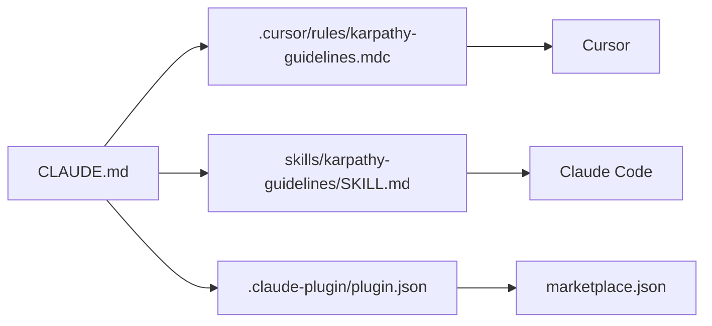

# forrestchang/andrej-karpathy-skills

> Un fichier CLAUDE.md de quatre règles de conduite pour freiner les dérives des agents de code.

## Le problème
Les agents de code supposent sans vérifier, sur-construisent et modifient du code voisin sans qu'on le leur ait demandé.

## Ce que ça fait vraiment
Un seul texte de consignes (réfléchir avant de coder, simplicité d'abord, changements chirurgicaux, exécution pilotée par des critères vérifiables), tiré de remarques d'Andrej Karpathy. Le même contenu est repackagé en règle Cursor, en skill et en plugin Claude Code. Aucun code exécuté : c'est du texte.

## Comment c'est branché


## Essayer
```bash
/plugin marketplace add forrestchang/andrej-karpathy-skills
/plugin install andrej-karpathy-skills@karpathy-skills
# ou, par projet :
curl -o CLAUDE.md https://raw.githubusercontent.com/forrestchang/andrej-karpathy-skills/main/CLAUDE.md
```

## Coût et pièges
Gratuit. Les consignes ajoutent du contexte à chaque session. Rien dans le README ne mesure leur effet : le critère « ça marche » est qualitatif (diffs plus petits, questions avant code).

## Ce que ce n'est pas
Pas un outil ni une garantie : une consigne reste une suggestion que le modèle peut ignorer. Pas de licence déclarée : réutilisation à clarifier avant de redistribuer. Les auteurs reconnaissent eux-mêmes un biais « prudence plutôt que vitesse ».

## Alternatives
- Multica (plateforme de l'auteur, citée en tête de README) : pour gérer des agents avec des skills réutilisables.

## Pour toi
Adopter : copier un fichier de règles coûte une minute et cadre l'agent, mais relis-le et adapte-le plutôt que de l'empiler tel quel sur tes propres règles.

