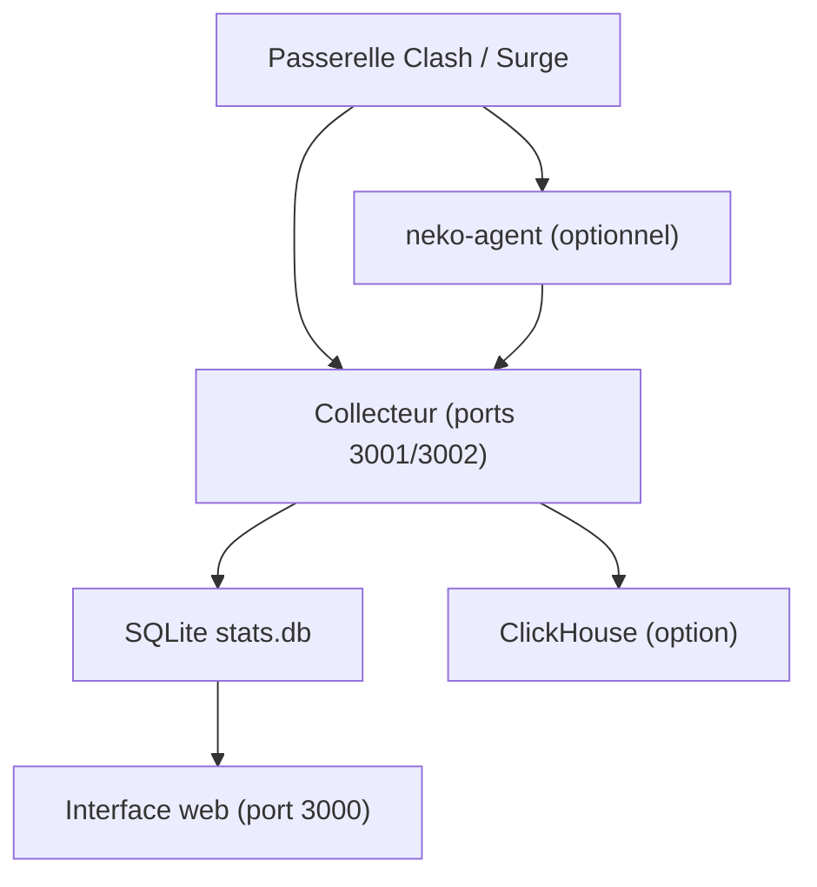

# foru17/neko-master

> Web dashboard that analyzes the network traffic of a Clash, Mihomo or Surge gateway.

## The problem
Home network gateways expose raw figures, hard to read by domain, IP or proxy node.

## What it actually does
It collects in real time (WebSocket, or HTTP polling for Surge) the traffic of one or more gateways and displays it by domain, IP and proxy, over 30 minutes, 1 h or 24 h. Data goes into SQLite, with ClickHouse as an option for large volumes. A lightweight agent can run on OpenWrt, Linux or macOS and report to the central panel. Interface in English and Chinese.

## How it is wired
Simplified diagram based on the sheet, no diagram provided.


## Trying it
```bash
export COOKIE_SECRET="$(openssl rand -hex 32)"
docker run -d --name neko-master -p 3000:3000 -v $(pwd)/data:/app/data -e COOKIE_SECRET="$COOKIE_SECRET" --restart unless-stopped foru17/neko-master:latest
```

## Cost and gotchas
Free. You need a compatible gateway. IP geolocation calls an online service by default; the local MMDB database requires GeoLite2 files to download. The install scripts pipe curl into bash.

## What it is not
It is not a network access or proxy service. It only analyzes the traffic of your own gateway.

## Alternatives
No alternative named in the README.

## For you
Ignore: this is home network monitoring, outside your data / AI / MLOps scope.
