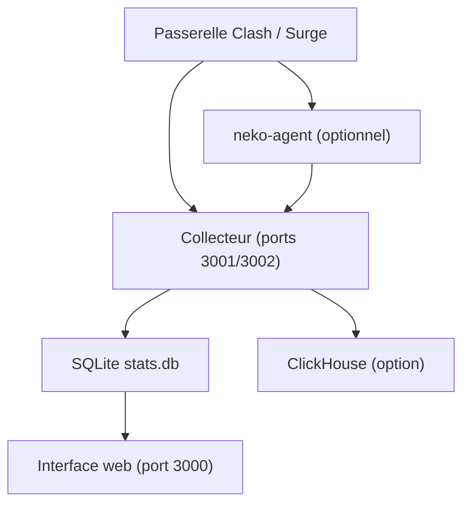

# foru17/neko-master

> Tableau de bord web qui analyse le trafic réseau d'une passerelle Clash, Mihomo ou Surge.

## Le problème
Les passerelles réseau domestiques exposent des chiffres bruts, difficiles à lire par domaine, IP ou nœud de proxy.

## Ce que ça fait vraiment
Il collecte en temps réel (WebSocket, ou interrogation HTTP pour Surge) le trafic d'une ou plusieurs passerelles et l'affiche par domaine, IP et proxy, sur 30 minutes, 1 h ou 24 h. Les données vont dans SQLite, avec ClickHouse en option pour de gros volumes. Un agent léger peut tourner sur OpenWrt, Linux ou macOS et reporter au panneau central. Interface en anglais et chinois.

## Comment c'est branché
Schéma simplifié d'après la fiche, sans diagramme fourni.


## Essayer
```bash
export COOKIE_SECRET="$(openssl rand -hex 32)"
docker run -d --name neko-master -p 3000:3000 -v $(pwd)/data:/app/data -e COOKIE_SECRET="$COOKIE_SECRET" --restart unless-stopped foru17/neko-master:latest
```

## Coût et pièges
Gratuit. Il faut une passerelle compatible. La géolocalisation IP appelle par défaut un service en ligne ; la base locale MMDB demande des fichiers GeoLite2 à télécharger. Les scripts d'installation se lancent par curl vers bash.

## Ce que ce n'est pas
Ce n'est pas un service d'accès réseau ni de proxy. Il n'analyse que le trafic de ta propre passerelle.

## Alternatives
Aucune alternative nommée dans le README.

## Pour toi
Ignorer : c'est de la supervision de réseau domestique, hors de ton périmètre data / IA / MLOps.

