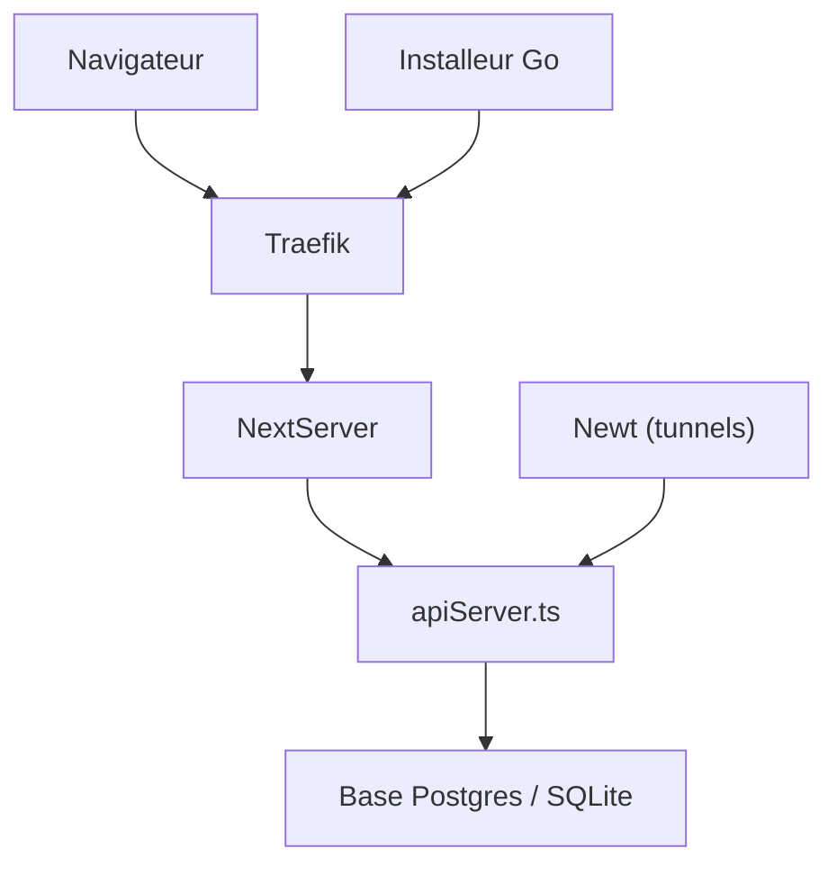

# fosrl/pangolin

> Open source SASE platform on WireGuard: zero-trust VPN, reverse proxy and AI gateway, self-hostable.

## The problem
Exposing private services without opening ports and without stacking separate VPN, proxy and access control.

## What it actually does
"Site" connectors open outbound WireGuard tunnels. A browser-based reverse proxy exposes HTTPS, VNC, RDP and SSH with SSO. Per-client access to private resources. An AI gateway in front of OpenAI, Anthropic, Ollama or vLLM, with budgets and history. According to the code: Next.js, TypeScript API, Traefik, CrowdSec, Drizzle on Postgres or SQLite, Go installer.

## How it is wired


## Trying it
```bash
# Aucune commande documentée dans ce README : voir le guide d'installation sur docs.pangolin.net.
```

## Cost and gotchas
Free Community edition (AGPL-3). Enterprise edition under a commercial license, free under $100,000 of annual revenue. Managed cloud is paid depending on the plan. You need a server and a domain.

## What it is not
Not a simple proxy: it is a complete platform, heavier to operate. Dual AGPL / commercial license.

## Alternatives
Cloudflare One, Zscaler and Prisma: cited as equivalent closed platforms.

## For you
Watch: interesting for exposing self-hosted models with identity and budgets; the mixed license and the breadth of scope call for a targeted trial.
