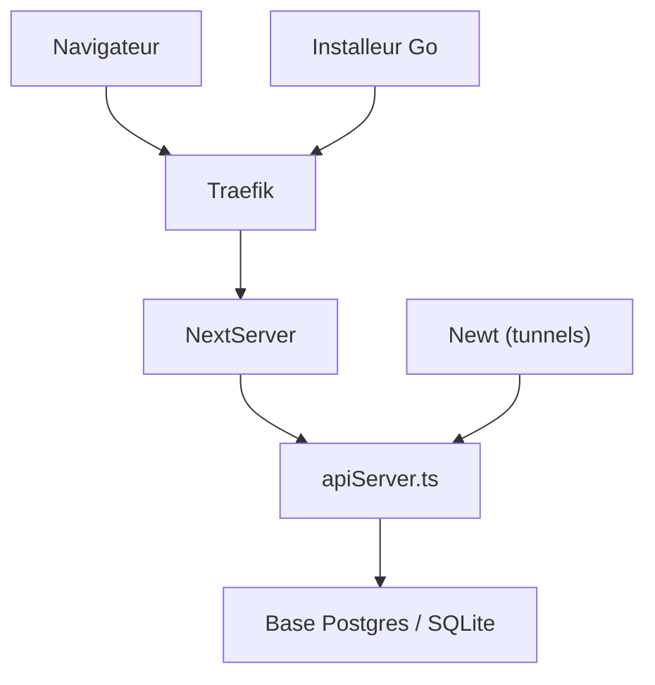

# fosrl/pangolin

> Plateforme SASE open source sur WireGuard : VPN zero-trust, reverse proxy et passerelle IA, auto-hébergeable.

## Le problème
Exposer des services privés sans ouvrir de ports et sans empiler VPN, proxy et contrôle d'accès séparés.

## Ce que ça fait vraiment
Des connecteurs « sites » ouvrent des tunnels sortants WireGuard. Un reverse proxy dans le navigateur expose HTTPS, VNC, RDP et SSH avec SSO. Un accès par client aux ressources privées. Une passerelle IA devant OpenAI, Anthropic, Ollama ou vLLM, avec budgets et historique. D'après le code : Next.js, API TypeScript, Traefik, CrowdSec, Drizzle sur Postgres ou SQLite, installeur Go.

## Comment c'est branché


## Essayer
```bash
# Aucune commande documentée dans ce README : voir le guide d'installation sur docs.pangolin.net.
```

## Coût et pièges
Édition Communauté gratuite (AGPL-3). Édition Entreprise sous licence commerciale, gratuite sous 100 000 $ de revenu annuel. Cloud géré payant selon l'offre. Il faut un serveur et un domaine.

## Ce que ce n'est pas
Pas un simple proxy : c'est une plateforme complète, plus lourde à exploiter. Double licence AGPL / commerciale.

## Alternatives
Cloudflare One, Zscaler et Prisma : cités comme plateformes équivalentes fermées.

## Pour toi
À surveiller : intéressant pour exposer des modèles auto-hébergés avec identité et budgets ; la licence mixte et l'ampleur du périmètre demandent un essai ciblé.

