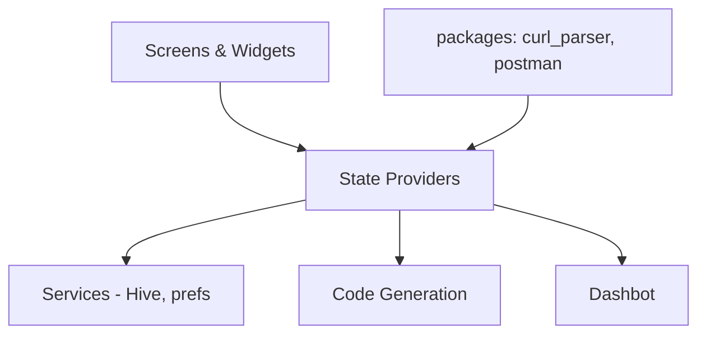

# foss42/apidash

> Cross-platform Flutter API client: HTTP, GraphQL, gRPC, AI, with code generation.

## The problem
Testing APIs and deriving integration code forces you to juggle several, often proprietary, tools.

## What it actually does
Builds and sends requests (HTTP, GraphQL, SSE, WebSocket, MQTT, gRPC, AI API requests), imports Postman, cURL, Insomnia, OpenAPI, HAR, and generates code for about thirty language/library pairs. DashBot is an assistant (local or cloud LLM) to debug and generate code. Monorepo: `lib/` (screens, providers, services, codegen) and `packages/` (core, design system, curl_parser…).

## How it is wired

## Trying it
No command in the README; downloads per OS (App Store, .dmg, .exe, .deb, .rpm).

## Cost and gotchas
Free. DashBot with a cloud LLM assumes an API key from your provider. hurl import not supported (open issue).

## What it is not
Not a load-testing bench nor a monitoring tool.

## Alternatives
No alternative named in the README.

## For you
Worth watching: handy for trying model APIs and generating clients, with Postman import, without an imposed cloud account.
