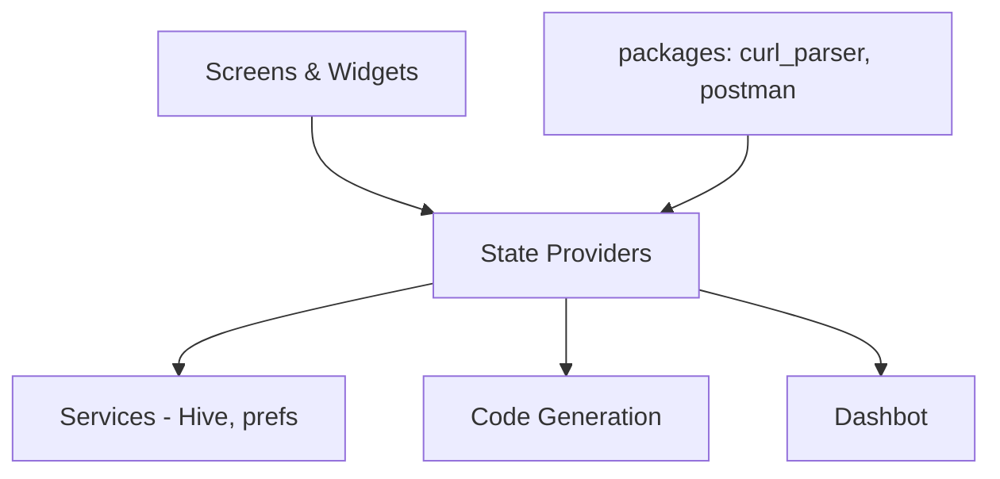

# foss42/apidash

> Client d'API Flutter multiplateforme : requêtes HTTP, GraphQL, gRPC, IA, avec génération de code.

## Le problème
Tester des API et en tirer du code d'intégration oblige à jongler entre plusieurs outils souvent propriétaires.

## Ce que ça fait vraiment
Construit et envoie des requêtes (HTTP, GraphQL, SSE, WebSocket, MQTT, gRPC, requêtes d'API d'IA), importe Postman, cURL, Insomnia, OpenAPI, HAR, et génère du code pour une trentaine de couples langage/bibliothèque. DashBot est un assistant (LLM local ou cloud) pour déboguer et générer du code. Monorepo : `lib/` (écrans, providers, services, codegen) et `packages/` (core, design system, curl_parser…).

## Comment c'est branché

## Essayer
Aucune commande dans le README ; téléchargements par OS (App Store, .dmg, .exe, .deb, .rpm).

## Coût et pièges
Gratuit. DashBot avec un LLM cloud suppose une clé d'API de ton fournisseur. Import hurl non pris en charge (issue ouverte).

## Ce que ce n'est pas
Pas un banc de test de charge ni un outil de monitoring.

## Alternatives
Aucune alternative nommée dans le README.

## Pour toi
À surveiller : pratique pour essayer des API de modèles et générer des clients, avec import Postman, sans compte cloud imposé.

