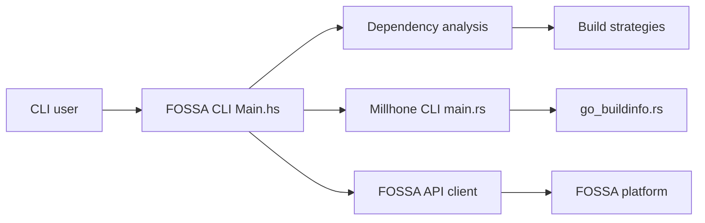

# fossas/fossa-cli

> Analyzes a project's dependencies and sends the result to the FOSSA platform, for compliance teams.

## The problem
Knowing which dependencies (and which licenses) a polyglot project ships requires reading each package manager by hand. Without an inventory, there is no compliance report or vulnerability audit.

## What it actually does
- `fossa analyze` automatically detects the dependencies of a directory, preferably from a working build, otherwise by inference from the sources.
- The result is uploaded to FOSSA (app.fossa.com), which runs the license and vulnerability analysis and produces attribution reports.
- `fossa test` returns the status of the checks for a CI integration.
- The repository also contains Millhone (Rust): container scanning, Go build info, a Berkeley DB parser. These features are described as still under development.

## How it is wired


## Trying it
```bash
curl -H 'Cache-Control: no-cache' https://raw.githubusercontent.com/fossas/fossa-cli/master/install-latest.sh | bash
export FOSSA_API_KEY=XXXX
cd $MY_PROJECT_DIR
fossa analyze
```
macOS alternative: `brew install --cask fossa`.

## Cost and gotchas
A FOSSA API key (account on app.fossa.com) is required for the main flow; the platform's pricing is not documented in the README. The install script is run directly from `curl | bash`.

## What it is not
Not a standalone scanner: license analysis, vulnerability analysis and reports go through the FOSSA service. Detection of vendored code, containers and system packages is presented as limited. The license is present but not identified by GitHub: read it before any use.

## Alternatives
No alternative named in the README.

## For you
Worth watching: useful if your team already has a FOSSA account for license compliance of polyglot ML projects, but without this SaaS the tool loses most of its appeal.
