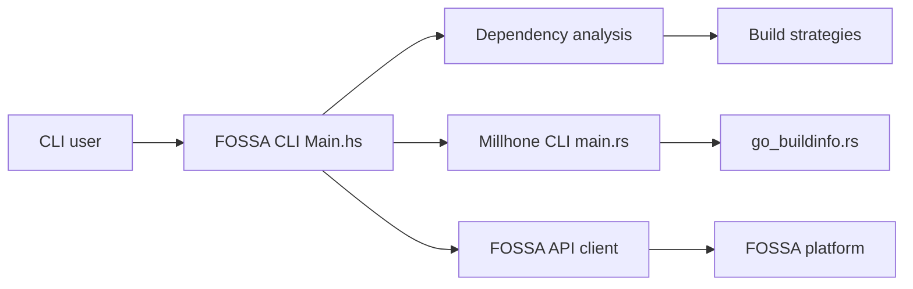

# fossas/fossa-cli

> Analyse les dépendances d'un projet et envoie le résultat à la plateforme FOSSA, pour équipes conformité.

## Le problème
Savoir quelles dépendances (et quelles licences) embarque un projet polyglotte demande de lire chaque gestionnaire de paquets à la main. Sans inventaire, pas de rapport de conformité ni d'audit de vulnérabilités.

## Ce que ça fait vraiment
- `fossa analyze` détecte automatiquement les dépendances d'un répertoire, de préférence à partir d'un build qui fonctionne, sinon par inférence depuis les sources.
- Le résultat est téléversé vers FOSSA (app.fossa.com), qui lance l'analyse de licences et de vulnérabilités et produit les rapports d'attribution.
- `fossa test` renvoie le statut des contrôles pour une intégration CI.
- Le dépôt contient aussi Millhone (Rust) : scan de conteneurs, infos de build Go, parseur Berkeley DB. Ces fonctions sont décrites comme encore en cours de développement.

## Comment c'est branché


## Essayer
```bash
curl -H 'Cache-Control: no-cache' https://raw.githubusercontent.com/fossas/fossa-cli/master/install-latest.sh | bash
export FOSSA_API_KEY=XXXX
cd $MY_PROJECT_DIR
fossa analyze
```
Alternative macOS : `brew install --cask fossa`.

## Coût et pièges
Une clé d'API FOSSA (compte sur app.fossa.com) est requise pour le flux principal ; les tarifs de la plateforme ne sont pas documentés dans le README. Le script d'installation est exécuté directement depuis `curl | bash`.

## Ce que ce n'est pas
Ce n'est pas un scanner autonome : l'analyse de licences, de vulnérabilités et les rapports passent par le service FOSSA. La détection vendored, conteneurs et paquets système est présentée comme limitée. La licence est présente mais non identifiée par GitHub : à lire avant tout usage.

## Alternatives
Aucune alternative nommée dans le README.

## Pour toi
À surveiller : utile si ton équipe a déjà un compte FOSSA pour la conformité des licences de projets ML polyglottes, mais sans ce SaaS l'outil perd l'essentiel de son intérêt.

