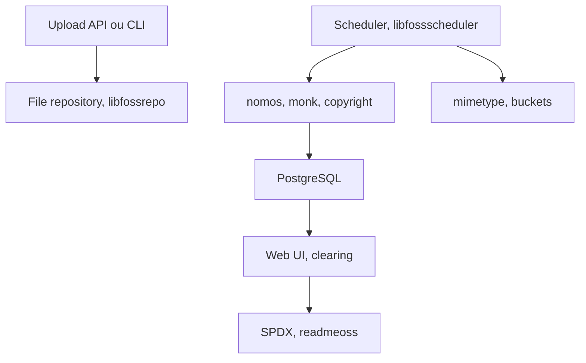

# fossology/fossology

> Open source system and toolkit for analyzing the licenses and copyrights of a piece of software.

## The problem
Knowing which licenses and copyrights are hiding in thousands of files is slow, especially with every new release.

## What it actually does
It analyzes code uploads: license detection, copyrights and export controls, with package metadata. Deduplication only rescans modified files. A PostgreSQL database and a web interface provide a review workflow; it produces an SPDX file or a copyright ReadMe in one click.

## How it is wired


## Trying it
```bash
docker run -p 8081:80 fossology/fossology
docker-compose up
vagrant up
```
Interface at `http://IP_OF_DOCKER_HOST:8081/repo`, default credentials fossy / fossy.

## Cost and gotchas
Free. Outside Docker, it needs PostgreSQL, Apache and PHP 7.3 or later. The standalone image does not persist data: an external database is recommended in production. Change the default password.

## What it is not
Not legal advice, as the README says. It does not replace a human review of the licenses.

## Alternatives
No alternative named in the README.

## For you
Worth watching: useful for auditing the licenses of the dependencies and models you integrate, especially in an enterprise context.
