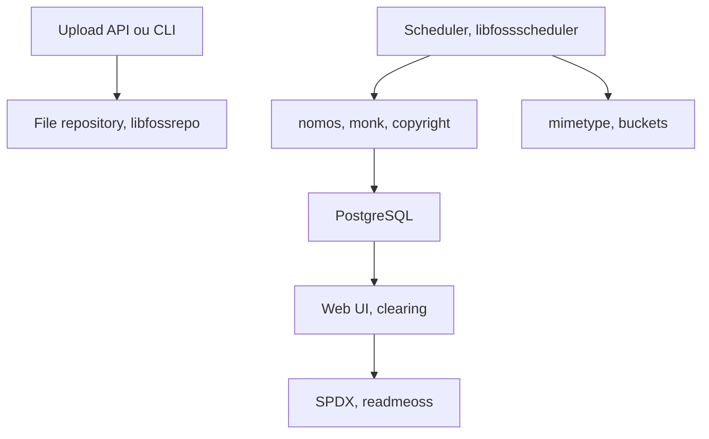

# fossology/fossology

> Système et boîte à outils open source pour analyser les licences et copyrights d'un logiciel.

## Le problème
Savoir quelles licences et quels copyrights se cachent dans des milliers de fichiers est long, surtout à chaque nouvelle version.

## Ce que ça fait vraiment
Il analyse des envois de code : détection de licences, copyrights et contrôles d'export, avec métadonnées de paquets. La déduplication ne rescanne que les fichiers modifiés. Une base PostgreSQL et une interface web donnent un flux de revue ; il produit un fichier SPDX ou un ReadMe des copyrights en un clic.

## Comment c'est branché


## Essayer
```bash
docker run -p 8081:80 fossology/fossology
docker-compose up
vagrant up
```
Interface sur `http://IP_OF_DOCKER_HOST:8081/repo`, identifiants par défaut fossy / fossy.

## Coût et pièges
Gratuit. Il faut PostgreSQL, Apache et PHP 7.3 ou plus hors Docker. L'image autonome ne persiste pas les données : une base externe est recommandée en production. Changer le mot de passe par défaut.

## Ce que ce n'est pas
Pas un conseil juridique, le README le dit. Il ne remplace pas une revue humaine des licences.

## Alternatives
Aucune alternative nommée dans le README.

## Pour toi
À surveiller : utile pour auditer les licences des dépendances et des modèles que tu intègres, surtout en contexte entreprise.

