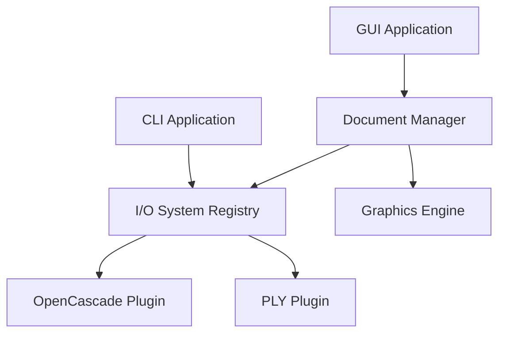

# fougue/mayo

> 3D CAD file viewer and converter (STEP, IGES, STL), with a graphical interface and a command line.

## The problem
Opening, measuring and converting CAD files often requires heavy or paid software.

## What it actually does
Mayo reads and writes STEP, IGES, STL and other formats, displays models with clipping planes, assembly explosion and measurements, and batch-converts from the command line. It is written in C++ with Qt and OpenCascade, and each format is an I/O module registered in a common core.

## How it is wired


## Trying it
```bash
winget install --id Fougue.Mayo
scoop bucket add extras
scoop install extras/mayo
```

## Cost and gotchas
Free (BSD-2-Clause). Packages are published for Windows and Linux; on macOS, you must build it. The real requirement is Qt and OpenCascade for building.

## What it is not
It is not CAD software for drawing: it views and converts. It has no data or AI side.

## Alternatives
No alternative named in the README.

## For you
Ignore: useful for converting CAD files occasionally, but outside the data, AI and MLOps scope.
