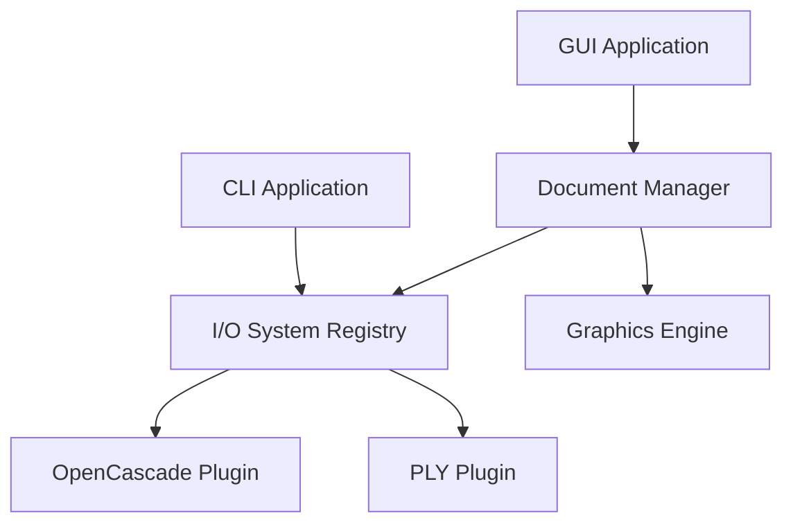

# fougue/mayo

> Visionneuse et convertisseur de fichiers CAO 3D (STEP, IGES, STL), en interface graphique et en ligne de commande.

## Le problème
Ouvrir, mesurer et convertir des fichiers CAO demande souvent un logiciel lourd ou payant.

## Ce que ça fait vraiment
Mayo lit et écrit STEP, IGES, STL et d'autres formats, affiche les modèles avec plans de coupe, éclaté d'assemblages et mesures, et convertit par lots en ligne de commande. Il est écrit en C++ avec Qt et OpenCascade, et chaque format est un module d'entrée-sortie enregistré dans un noyau commun.

## Comment c'est branché


## Essayer
```bash
winget install --id Fougue.Mayo
scoop bucket add extras
scoop install extras/mayo
```

## Coût et pièges
Gratuit (BSD-2-Clause). Des paquets sont publiés pour Windows et Linux ; sur macOS, il faut compiler. Le besoin réel est Qt et OpenCascade pour la compilation.

## Ce que ce n'est pas
Ce n'est pas un logiciel de CAO pour dessiner : il visualise et convertit. Il n'a pas de volet data ou IA.

## Alternatives
Aucune alternative nommée dans le README.

## Pour toi
À ignorer : utile pour convertir des fichiers CAO ponctuellement, mais hors du périmètre data, IA et MLOps.

