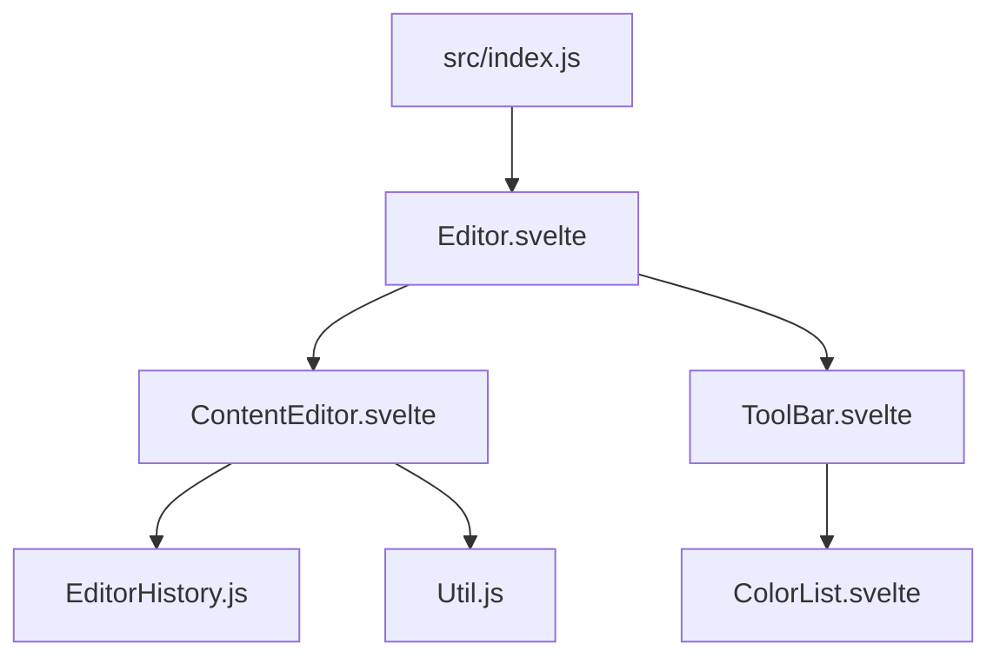

# fouita/tailwind-editor

> Notion-style Svelte editor component that outputs Tailwind HTML, for Svelte developers.

## The problem
Generating Tailwind-styled HTML from visual editing otherwise means writing it by hand.

## What it actually does
`Editor` is a Svelte component with a toolbar (colors, alignment, spacing) and history. It exposes the produced HTML via `bind:html`, and can load initial HTML. The README warns that it is under development and advises against production use; lists, media and drag-and-drop are still to do.

## How it is wired


## Trying it
```bash
npm i tailwind-editor
```

## Cost and gotchas
Free. You need a Svelte project with Tailwind installed; last push in December 2024.

## What it is not
It is not production-ready (says the README) and it is not a full editor: no lists or media.

## Alternatives
No alternative named in the README.

## For you
Ignore: experimental, little-maintained front-end tool, outside your data / AI field.
