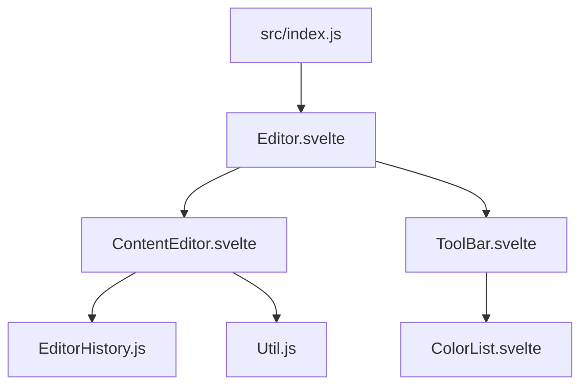

# fouita/tailwind-editor

> Composant Svelte d'éditeur type Notion qui produit du HTML Tailwind, pour les développeurs Svelte.

## Le problème
Générer du HTML stylé en Tailwind à partir d'une édition visuelle demande de l'écrire à la main.

## Ce que ça fait vraiment
`Editor` est un composant Svelte avec barre d'outils (couleurs, alignement, espacements) et historique. Il expose le HTML produit par `bind:html`, et peut charger du HTML initial. Le README prévient qu'il est en développement et déconseille la production ; listes, médias et glisser-déposer restent à faire.

## Comment c'est branché


## Essayer
```bash
npm i tailwind-editor
```

## Coût et pièges
Gratuit. Il faut un projet Svelte avec Tailwind installé ; dernier push en décembre 2024.

## Ce que ce n'est pas
Ce n'est pas prêt pour la production (dit par le README) et ce n'est pas un éditeur complet : pas de listes ni de médias.

## Alternatives
Aucune alternative nommée dans le README.

## Pour toi
À ignorer : outil front-end expérimental et peu suivi, hors de ton champ data / IA.

