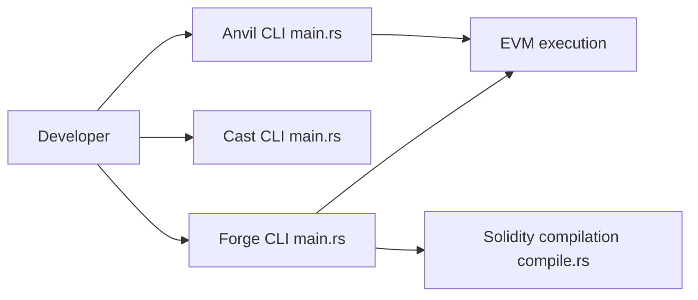

# foundry-rs/foundry

> Rust toolkit for developing, testing and deploying Ethereum smart contracts.

## The problem
Developing Solidity contracts requires compiling, testing, fuzzing, debugging and interacting with the chain.

## What it actually does
Four tools: Forge (compilation, tests, fuzzing, debugging, lint, LSP server), Cast (RPC calls, transactions, chain reads), Anvil (local node with fork) and Chisel (Solidity REPL). They share compilation, EVM execution and traces.

## How it is wired


## Trying it
```bash
curl -L https://foundry.paradigm.xyz | bash
foundryup
forge init counter && cd counter
forge build
forge test
cast block-number --rpc-url https://eth.merkle.io
anvil --fork-url https://eth.merkle.io
```

## Cost and gotchas
Free. An RPC endpoint is needed to interact with a public chain; the install script runs through curl.

## What it is not
Not a wallet nor an automatically audited security tool. The README emphasizes speed without figures.

## Alternatives
No alternative named in the README.

## For you
Ignore: Ethereum contract development, outside your data/AI/MLOps scope.
