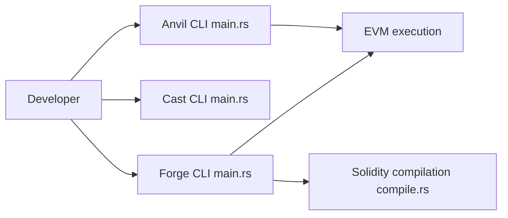

# foundry-rs/foundry

> Boîte à outils Rust pour développer, tester et déployer des contrats intelligents Ethereum.

## Le problème
Développer des contrats Solidity demande de compiler, tester, fuzzer, déboguer et interagir avec la chaîne.

## Ce que ça fait vraiment
Quatre outils : Forge (compilation, tests, fuzzing, débogage, lint, serveur LSP), Cast (appels RPC, transactions, lecture de chaîne), Anvil (nœud local avec fork) et Chisel (REPL Solidity). Ils partagent compilation, exécution EVM et traces.

## Comment c'est branché


## Essayer
```bash
curl -L https://foundry.paradigm.xyz | bash
foundryup
forge init counter && cd counter
forge build
forge test
cast block-number --rpc-url https://eth.merkle.io
anvil --fork-url https://eth.merkle.io
```

## Coût et pièges
Gratuit. Un point d'accès RPC est nécessaire pour interagir avec une chaîne publique ; le script d'installation s'exécute via curl.

## Ce que ce n'est pas
Pas un portefeuille ni un outil de sécurité audité automatiquement. Le README met en avant la vitesse sans chiffres.

## Alternatives
Aucune alternative nommée dans le README.

## Pour toi
À ignorer : développement de contrats Ethereum, hors de ton périmètre data/IA/MLOps.

