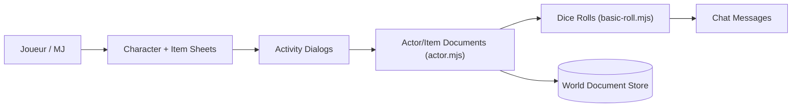

# foundryvtt/dnd5e

> D&D 5e game system for Foundry Virtual Tabletop: sheets, dice, rules and content.

## The problem
Playing D&D 5e on a virtual tabletop requires character sheets, dice rules and built-in compendiums.

## What it actually does
Provides actor and item sheets, dice and rules mechanics, class advancement, combat tracking, a compendium browser (monsters, heroes, items, spells, features). Based on the code: actor/item documents, activities, chat messages, active effects, dice rolls and token targeting.

## How it is wired

## Trying it
Paste the URL into Foundry's "Install System" box: `https://raw.githubusercontent.com/foundryvtt/dnd5e/master/system.json`. Alternative method: clone into `Data/systems/dnd5e`.

## Cost and gotchas
Foundry VTT (commercial licensed software) must already be installed. 921 open issues.

## What it is not
It is not a standalone game: it is a module for Foundry. The README is short; help is in the wiki.

## Alternatives
The README cites no alternative.

## For you
Ignore: role-playing game extension, of no use to a data/AI/MLOps profile.
