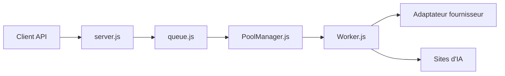

# foxhui/WebAI2API

> Turns AI websites (LMArena, Gemini, ChatGPT…) into an OpenAI-compatible API through browser automation.

## The problem
Models available only through a web interface cannot be called from code or from tools that speak the OpenAI format.

## What it actually does
Drives a Camoufox (Playwright) browser that imitates typing and mouse movements to interact with the sites. Exposes `/v1/chat/completions`, `/v1/models` and `/v1/cookies`, with a task queue, worker pool, failover, streaming with keep-alive, isolated multi-accounts and a web interface (logs, VNC). Text, image and video depending on the site.

## How it is wired


## Trying it
```bash
pnpm install
npm run init
npm start
docker run -d --name webai-2api -p 3000:3000 -v "$(pwd)/data:/app/data" --shm-size=2gb foxhui/webai-2api:latest
```

## Cost and gotchas
Free, but one account per site and an initial manual login are required. The web interface is not encrypted; resources: 2 GB of RAM recommended. Risk of account ban, with an explicit warning from the author.

## What it is not
Not an official API: the human-imitation mechanisms aim to evade detection, which may violate the sites' terms. Fragile to interface changes.

## Alternatives
No alternative named in the README.

## For you
Ignore: detection circumvention and violated terms of use, with weak guarantees; use the providers' official APIs.
