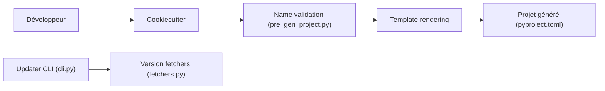

# fpgmaas/cookiecutter-uv

> Cookiecutter template that generates a modern, fully tooled Python project (uv, CI, tests, docs), for Python developers.

## The problem
Starting a clean Python project requires manually setting up dependency management, quality checks, CI and publishing.

## What it actually does
- Generates a uv-managed project, in `src` or flat layout.
- Adds GitHub Actions, pre-commit, ruff, mypy/ty, deptry, pytest and codecov, PyPI publishing on GitHub release.
- Optional MkDocs or Zensical documentation, multi-version tests with tox-uv, Docker or Podman, VSCode devcontainer.
- A separate CLI updates the versions of the template's dependencies and tools.

## How it is wired


## Trying it
```bash
uvx cookiecutter https://github.com/osprey-oss/cookiecutter-uv.git
# ou, sans uv :
pip install cookiecutter
cookiecutter https://github.com/osprey-oss/cookiecutter-uv.git
```

## Cost and gotchas
Free. The README points to the address `osprey-oss/cookiecutter-uv` (the repository may have changed organization). Then follow the README of the generated project.

## What it is not
Not a framework: it writes files once, then the project is yours. Not data-science oriented in particular (no notebook or ML template).

## Alternatives
No alternative named in the README.

## For you
Adopt: real time saved to bootstrap a Python package or service with CI, tests and publishing already wired.
