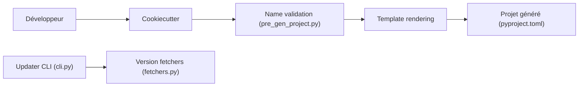

# fpgmaas/cookiecutter-uv

> Modèle Cookiecutter qui génère un projet Python moderne outillé (uv, CI, tests, docs), pour développeurs Python.

## Le problème
Démarrer un projet Python propre demande de configurer à la main gestion des dépendances, qualité, CI et publication.

## Ce que ça fait vraiment
- Génère un projet géré par uv, en layout `src` ou plat.
- Ajoute GitHub Actions, pre-commit, ruff, mypy/ty, deptry, pytest et codecov, publication PyPI à la release GitHub.
- Option de documentation MkDocs ou Zensical, tests multi-versions avec tox-uv, Docker ou Podman, devcontainer VSCode.
- Un CLI séparé met à jour les versions des dépendances et outils du modèle.

## Comment c'est branché


## Essayer
```bash
uvx cookiecutter https://github.com/osprey-oss/cookiecutter-uv.git
# ou, sans uv :
pip install cookiecutter
cookiecutter https://github.com/osprey-oss/cookiecutter-uv.git
```

## Coût et pièges
Gratuit. Le README renvoie vers l'adresse `osprey-oss/cookiecutter-uv` (le dépôt a pu changer d'organisation). Suivre ensuite le README du projet généré.

## Ce que ce n'est pas
Pas un framework : il écrit des fichiers une fois, puis le projet t'appartient. Pas orienté data science en particulier (pas de gabarit notebook ou ML).

## Alternatives
Aucune alternative nommée dans le README.

## Pour toi
À adopter : gain de temps réel pour amorcer un package ou un service Python avec CI, tests et publication déjà câblés.

