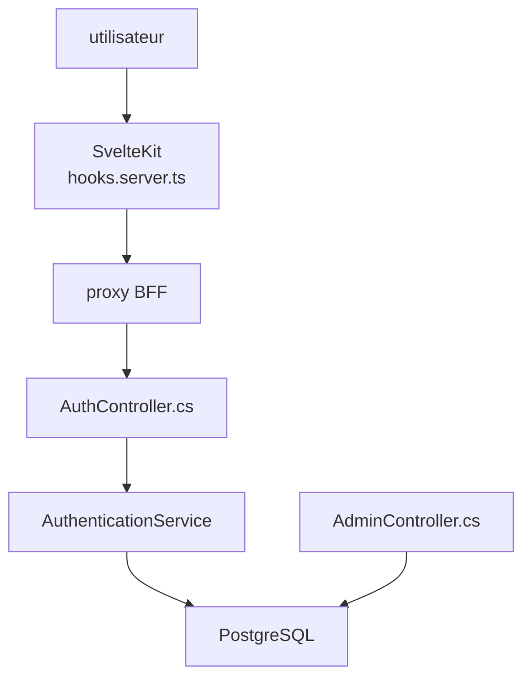

# fpindej/netrock

> Full-stack .NET 10 and SvelteKit template with authentication, roles and administration, for launching a web product.

## The problem
Every web product starts over with authentication, roles, rate limiting, Docker and API documentation before any business logic.

## What it actually does
.NET API with JWT and token rotation, TOTP, OAuth with 10 providers, roles and permissions, auditing, Hangfire jobs, S3 storage, PostgreSQL. SvelteKit frontend with a BFF proxy. Also ships more than 20 Claude Code skills and an initialization script that renames the project.

## How it is wired


## Trying it
```bash
git clone https://github.com/fpindej/netrock.git my-saas
cd my-saas
./init.sh
dotnet run --project src/backend/MyProject.AppHost
```

## Cost and gotchas
Docker Desktop, .NET 10 SDK (not in the list), Node 24+ and Git. A superuser is created with default credentials that must be changed.

## What it is not
Not a generic template: imposed choices (PostgreSQL, JWT cookies). Not a microservices framework.

## Alternatives
Not documented in the README.

## For you
Ignore: a .NET web foundation for SaaS products, unrelated to data, AI or MLOps needs.
