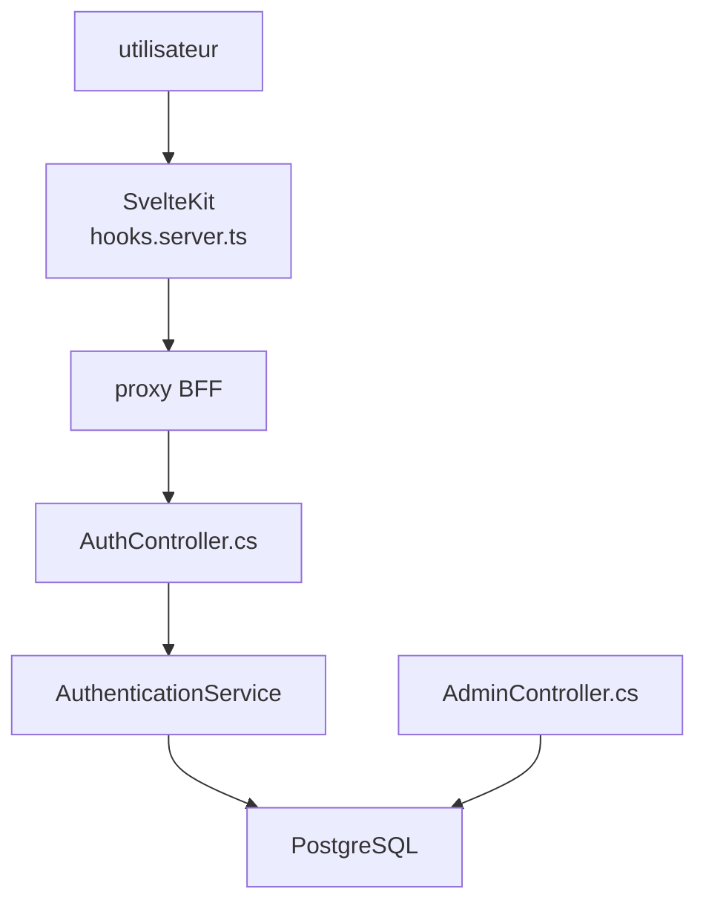

# fpindej/netrock

> Gabarit full-stack .NET 10 et SvelteKit avec authentification, rôles, administration, pour lancer un produit web.

## Le problème
Chaque produit web recommence authentification, rôles, limitation de débit, Docker et documentation d'API avant la moindre logique métier.

## Ce que ça fait vraiment
API .NET avec JWT et rotation de jetons, TOTP, OAuth avec 10 fournisseurs, rôles et permissions, audit, tâches Hangfire, stockage S3, PostgreSQL. Frontend SvelteKit avec proxy BFF. Fournit aussi plus de 20 skills Claude Code et un script d'initialisation qui renomme le projet.

## Comment c'est branché


## Essayer
```bash
git clone https://github.com/fpindej/netrock.git my-saas
cd my-saas
./init.sh
dotnet run --project src/backend/MyProject.AppHost
```

## Coût et pièges
Docker Desktop, SDK .NET 10 (non dans la liste), Node 24+ et Git. Un superutilisateur est créé avec des identifiants par défaut à changer.

## Ce que ce n'est pas
Pas un gabarit générique : choix imposés (PostgreSQL, cookies JWT). Pas un framework de microservices.

## Alternatives
Non documenté dans le README.

## Pour toi
À ignorer : socle web .NET pour produits SaaS, sans lien avec les besoins data, IA ou MLOps.

